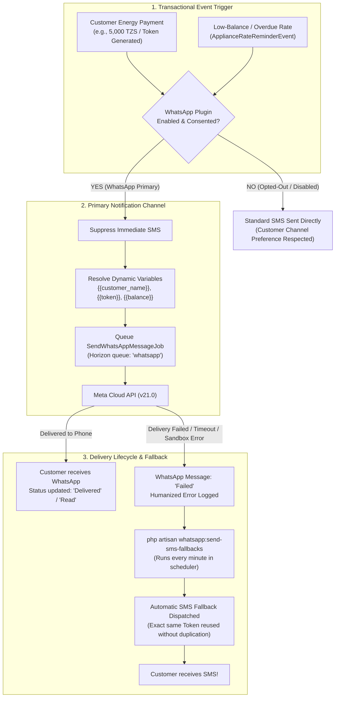

# PowerEcho — WhatsApp Business API Plugin Demo & Admin Guide
**MicroPowerManager (MPM) Hackathon Challenge**

> [!NOTE]
> This guide is an end-to-end evaluation walkthrough and administrator setup guide for the **PowerEcho WhatsApp Business API Plugin** in EnAccess MicroPowerManager (MPM). It covers:
> 1. External Account Setup (Meta for Developers & Africa's Talking SMS)
> 2. Administrator Configuration in MicroPowerManager UI
> 3. Template Architecture & Dynamic Variable Resolution
> 4. Outbound Delivery & Human-Friendly Provider Error Explanations
> 5. End-to-End Payment Simulation (WhatsApp Primary Channel)
> 6. Low-Balance & Overdue Tariff Warnings
> 7. Meta Cloud API Webhook Simulation (Delivery Status Updates & Inbound Keywords)
> 8. Customer Consent, Channel Preferences & Opt-Out Handling (`STOP` / `START`)
> 9. Resilient Automatic SMS Fallback Engine (Protecting energy tokens during provider outages)

---

## 1. Quick Environment & Access Reference

| Component | Access URL / Details | Notes |
| :--- | :--- | :--- |
| **MPM Web Application** | `http://localhost:8001` | Vue 2 / Vue Material Operator Dashboard |
| **WhatsApp Overview** | `http://localhost:8001/#/whatsapp/overview` | Delivery rate & recent activity |
| **WhatsApp Settings** | `http://localhost:8001/#/whatsapp/settings` | Meta Cloud API credentials & notification toggles |
| **WhatsApp Templates** | `http://localhost:8001/#/whatsapp/templates` | Template registry & placeholder definitions |
| **WhatsApp Messages** | `http://localhost:8001/#/whatsapp/messages` | Live testing tool & message history table |
| **SMS Gateway Settings** | `http://localhost:8001/#/africas-talking/africas-talking-overview` | Africa's Talking credentials & callbacks |
| **Main System Settings** | `http://localhost:8001/#/settings/main-settings` | Active SMS Gateway selection (`AfricasTalking` / `TextBee`) |
| **Backend Container** | `backend-dev` (Apache / PHP 8.3) | Port `8000` |
| **MySQL Container** | `mysql` (Root password: `wF9zLp2qRxaS2e`) | Database: `DemoCompany_1` |

---

## 2. Architecture & Notification Flow



---

## 3. External Accounts & Prerequisites Setup

### A. Meta for Developers (WhatsApp Cloud API)

To send live WhatsApp messages, an administrator requires a free Meta Developer Account:

1. **Create / Log in to Meta Developers**:
   - Navigate to [developers.facebook.com](https://developers.facebook.com).
   - Log in with your Facebook account.
2. **Create an App**:
   - Click **My Apps** > **Create App**.
   - Select **Other** as the use case, then choose **Business** as the app type.
   - Enter an App Name (e.g., `MPM Notification Plugin`) and your contact email.
   - Click **Create App**.
3. **Add the WhatsApp Product**:
   - On the App Dashboard, click **Use Cases** (or click **Add Use Cases**).
   - Locate **WhatsApp** (*"Send messages with WhatsApp"*) and click **Set up**.
   - Under **WhatsApp Business Platform**, select or create your business portfolio and click **Continue**.
4. **Access Sandbox Credentials ("Step 1. Try it out")**:
   - Click **Step 1. Try it out** in the left sidebar.
   - Click **Generate token** to produce your temporary **API Access Token** (or create a permanent System User Token in Business Manager).
   - Note down:
     - **Phone Number ID**: (e.g. `1408059115718896`)
     - **WhatsApp Business Account ID**: (e.g. `1136145768986544`)
     - **Test Sender Phone Number**: (e.g. `+1 (555) 651-0112`)
     - **API Version**: `v21.0`
5. **Whitelist Recipient Phone Numbers**:
   - In the Meta Sandbox, messages can only be delivered to verified tester numbers.
   - Under **Send a message from your test number**, open the **Recipient** dropdown.
   - Click **Manage phone number list** > **Add phone number**.
   - Enter your real mobile number (e.g. `+250791396281`) and verify it via the 6-digit SMS/WhatsApp code.
   - *Sandbox note*: If Meta locks the test account (Error `#131031`), our built-in resilient SMS fallback automatically intercepts the message and delivers the token via SMS!

---

### B. Africa's Talking (Resilient SMS Fallback Gateway)

To deliver real SMS fallbacks in Africa (Rwanda `+250`, Kenya `+254`, Tanzania `+255`, Uganda `+256`):

1. **Create an Account**:
   - Sign up at [africastalking.com](https://africastalking.com).
2. **Access Sandbox**:
   - Open the **Sandbox** application.
   - Username is `sandbox`.
3. **Generate an API Key**:
   - Navigate to **Settings** > **API Key**.
   - Enter your password to generate a fresh API key.
4. *Internal SMS Testing*: Even without live SMS credits, MPM records every fallback SMS in the `sms` database table with the exact token and status.

---

## 4. Administrator Setup Guide in MicroPowerManager

### Step 1: Configure WhatsApp Credentials
1. Open your browser and navigate to:
   👉 **`http://localhost:8001/#/whatsapp/settings`**
2. Fill in your credentials:
   - **Enable WhatsApp notifications**: Toggle switch to **ON**.
   - **API Access Token**: Paste the Meta token generated from your Meta app.
   - **Phone Number ID**: Paste your Meta Phone Number ID (e.g. `1408059115718896`).
   - **WhatsApp Business Account ID**: Paste your WABA ID (e.g. `1136145768986544`).
   - **API Version**: `v21.0`.
   - **Sender / Phone Number**: Your configured sender (e.g. `+1 (555) 651-0112`).
   - **Webhook Verification Token**: Any secure secret passphrase (e.g. `mpm_webhook_secret_2026`).
3. Under **Notification Preferences**, verify all three events are toggled **ON**:
   - Payment receipts
   - Low-balance warnings
   - Token deliveries
4. Click **Save settings**.
   - A green banner displays at the top: *"WhatsApp settings saved successfully."*
   - All fields remain populated, and the Access Token displays `✓ Token saved in database`.

### Step 2: Configure SMS Fallback Gateway
1. Navigate to:
   👉 **`http://localhost:8001/#/africas-talking/africas-talking-overview`**
2. Enter your Africa's Talking credentials:
   - **Username**: `sandbox`
   - **API Key**: *[Your Africa's Talking API Key]*
   - Click **Save**.
3. Go to **Main Settings**:
   👉 **`http://localhost:8001/#/settings/main-settings`**
4. Scroll to **SMS Gateway** and select **AfricasTalking** (or **TextBee**).
5. Ensure **Transaction SMS** is enabled, then click **Save**.

---

## 5. Reviewer CLI Simulation Suite

All commands execute inside the `backend-dev` container:

| Command | Purpose | Example |
| :--- | :--- | :--- |
| `whatsapp:simulate-payment` | Simulate customer electricity payment with token generation | `docker exec backend-dev php artisan whatsapp:simulate-payment 250791396281 --amount=5000 --company-id=1` |
| `whatsapp:simulate-low-balance` | Simulate low-balance or overdue appliance rate reminder | `docker exec backend-dev php artisan whatsapp:simulate-low-balance 250791676207 --company-id=1` |
| `whatsapp:simulate-webhook` | Simulate Meta Cloud API delivery updates & inbound keywords | `docker exec backend-dev php artisan whatsapp:simulate-webhook --status=delivered --company-id=1` |
| `whatsapp:opt-out` | Manage customer consent & channel preferences (WhatsApp vs SMS) | `docker exec backend-dev php artisan whatsapp:opt-out 250791676207 --status --company-id=1` |
| `whatsapp:send-sms-fallbacks` | Trigger SMS fallback engine for failed or timed-out messages | `docker exec backend-dev php artisan whatsapp:send-sms-fallbacks --force --company-id=1` |

---

## 6. Click-by-Click Live Demo Walkthrough

### Step 1: Admin Configuration & Credential Persistence
**Goal**: Verify that operators can configure their Meta Cloud API credentials and that secrets persist safely without form clearing or validation bugs.

1. In your browser, open:
   👉 **`http://localhost:8001/#/whatsapp/settings`**
2. Verify:
   - **Phone Number ID**: `1408059115718896`.
   - **WhatsApp Business Account ID**: `1136145768986544`.
   - **Sender Phone Number**: `+1 (555) 651-0112`.
   - **API Version**: `v21.0`.
   - **API Access Token**: Masked with `••••••••` and tagged with `✓ Token saved in database`.
3. Click **"Save Settings"**:
   - Confirmation displays at the top: *"WhatsApp settings saved successfully."*
   - All fields remain populated and retain their masked states.

---

### Step 2: Message Templates & Dynamic Variable Structure
**Goal**: Demonstrate how MPM separates messaging templates into standardized business notifications with dynamic variable placeholders.

1. Click **"Templates"** in the left sidebar or open:
   👉 **`http://localhost:8001/#/whatsapp/templates`**
2. Review the 3 core energy access templates:
   - **Token Delivery**:
     `Hello {{customer_name}}, your token is {{token}}. Thank you for your payment.`
   - **Payment Receipt**:
     `Hello {{customer_name}}, we have received your payment of {{payment_amount}} {{currency}} on {{payment_date}}. Transaction reference: {{transaction_id}}.`
   - **Low-Balance Warning**:
     `Hello {{customer_name}}, your outstanding balance is {{balance}} {{currency}}. Please settle it before {{due_date}}.`
3. Point out that raw placeholders (`{{...}}`) are strictly validated and dynamically resolved into real customer data at send time.

---

### Step 3: Outbound WhatsApp Delivery with Real Variables
**Goal**: Send a live WhatsApp notification to an actual physical smartphone and prove variables are replaced (no unparsed `{{...}}` sent).

1. Click **"Message History"** in the left sidebar or open:
   👉 **`http://localhost:8001/#/whatsapp/messages`**
2. Locate the **"Send test message"** card at the top:
   - **Recipient phone number**: Enter your verified phone: `+250791396281`
   - **Template**: Select **"Token delivery"** from the dropdown.
3. Click **"Send test message"**:
   - Notification appears: *"Test message sent successfully."*
   - Phone number stays populated in the input field for easy repeat testing.
4. **Show Audience the Recipient Phone**:
   - The WhatsApp notification pops up on the phone.
   - Content: *"Hello John Doe, your token is 4829-1094-8832. Thank you for your payment."*
5. **Show the Message History Table**:
   - The newly sent message is at the top of the table.
   - **Customer**: `John Doe` / `250791396281`.
   - **Type**: `Token delivery`.
   - **Status**: Green `Sent` badge.
   - **External Message ID**: Official Meta `wamid.HBg...` identifier.

---

### Step 4: Human-Friendly Provider Error Handling
**Goal**: Demonstrate that when Meta rejects a message or locks an account, operators receive clear English guidance instead of raw technical codes (`#131030`, `#131031`, `#131047`).

| Meta Error Code | Raw Provider Error | Humanized Explanation in MPM UI |
| :--- | :--- | :--- |
| **#131030** | Recipient not in allowed list | *Recipient phone number is not registered in your Meta Developer Sandbox. Please add it to your allowed recipient list in Meta Developer Portal.* |
| **#131031** | Business Account locked | *WhatsApp Business account is temporarily locked or restricted by Meta. System will automatically route to SMS fallback.* |
| **#131047** | Re-engagement message (>24h) | *Customer service window closed. More than 24 hours have passed since the customer last replied.* |
| **#190** | Invalid OAuth access token | *Meta API access token expired. Please generate a new token in Meta and save it in WhatsApp Settings.* |

---

### Step 5: End-to-End Customer Payment Simulation (WhatsApp Primary)
**Goal**: Simulate a real utility customer paying for electricity via mobile money. Show that WhatsApp is the **Primary Channel** and suppresses standard SMS.

1. Run the payment simulation command:
   ```powershell
   docker exec backend-dev php artisan whatsapp:simulate-payment 250791396281 --amount=5000 --company-id=1
   ```
2. Observe CLI output:
   ```text
   Simulating energy payment of 5000 TZS for customer 250791396281...
   ✓ Transaction created [ID: 998993887] with Token [7237-7959-5817]
   ✓ TransactionSuccessfulEvent fired!
   ✓ Standard SMS suppressed (WhatsApp is Primary channel)
   ✓ WhatsApp token notification dispatched to 250791396281
   ```
3. Verify in the UI (`http://localhost:8001/#/whatsapp/messages`):
   - The new payment token delivery message is displayed in the table.
   - The customer receives their meter token immediately on WhatsApp.

---

### Step 6: Meta Webhook Lifecycle Simulation (No Tunnel Required)
**Goal**: Demonstrate that delivery receipt webhooks from Meta update message statuses to `Delivered` and `Read` without requiring an ngrok tunnel.

1. Simulate Meta Cloud API confirming delivery:
   ```powershell
   docker exec backend-dev php artisan whatsapp:simulate-webhook --status=delivered --company-id=1
   ```
   **Output**:
   ```text
   ✓ Message [ID: 26, Type: token_delivery] updated via simulated webhook to [delivered]!
   ```
2. Refresh the UI table at `http://localhost:8001/#/whatsapp/messages`:
   - Status badge transitions from **Sent** to **Delivered**!
3. Simulate customer reading the message:
   ```powershell
   docker exec backend-dev php artisan whatsapp:simulate-webhook --status=read --company-id=1
   ```
   - Status badge transitions to **Read**!

---

### Step 7: Customer Consent & Opt-Out Handling (STOP / START)
**Goal**: Demonstrate compliance with Meta policy and customer choice: if a customer opts out of WhatsApp, MPM honors their preference and automatically routes all future tokens and receipts to SMS.

1. Check current customer consent status:
   ```powershell
   docker exec backend-dev php artisan whatsapp:opt-out 250791396281 --status --company-id=1
   ```
2. Simulate customer texting **"STOP"** on WhatsApp:
   ```powershell
   docker exec backend-dev php artisan whatsapp:simulate-webhook --inbound="STOP" --phone=250791396281 --company-id=1
   ```
   **Output**:
   ```text
   ✓ Inbound keyword recognized!
   Auto-reply sent to customer: "You have been unsubscribed from WhatsApp notifications. You will receive electricity and payment updates via SMS instead. Reply START to re-subscribe anytime."
   Consent updated: Opted Out (SMS Fallback active)
   ```
3. Simulate an energy payment for this opted-out customer:
   ```powershell
   docker exec backend-dev php artisan whatsapp:simulate-payment 250791396281 --amount=4000 --company-id=1
   ```
   **Result**: WhatsApp is skipped; token is delivered via **native SMS** directly!
4. Customer re-subscribes by texting **"START"**:
   ```powershell
   docker exec backend-dev php artisan whatsapp:simulate-webhook --inbound="START" --phone=250791396281 --company-id=1
   ```
   **Output**:
   ```text
   ✓ Inbound keyword recognized!
   Consent updated: Opted In (WhatsApp active)
   ```

---

### Step 8: Automatic SMS Fallback Demonstration
**Goal**: Prove the core resilience feature: if WhatsApp fails (e.g. Meta account lock `#131031`, network outage, or customer without internet), MPM automatically falls back to SMS without duplicating or changing the token.

1. Simulate a customer payment where WhatsApp delivery fails:
   ```powershell
   docker exec backend-dev php artisan whatsapp:simulate-payment 250791396281 --amount=5000 --fail --company-id=1
   ```
2. Observe CLI output:
   ```text
   ✓ Transaction created [ID: 998993888] with Token [9067-3272-5879]
   Simulating WhatsApp delivery failure...
   ✗ WhatsApp delivery failed [Message ID: 27]
   Run 'php artisan whatsapp:send-sms-fallbacks' to demonstrate automatic SMS fallback!
   ```
3. Trigger the SMS fallback worker (which runs automatically every minute in production):
   ```powershell
   docker exec backend-dev php artisan whatsapp:send-sms-fallbacks --force --company-id=1
   ```
4. Observe CLI output:
   ```text
   SMS fallbacks sent: 1
   ```
5. Check the database to show proof of fallback:
   ```powershell
   docker exec mysql mysql -uroot -pwF9zLp2qRxaS2e -e "SELECT id, trigger_id, body FROM DemoCompany_1.sms ORDER BY id DESC LIMIT 1;"
   ```
   **Output**:
   ```text
   id: 1
   trigger_id: 998993888
   body: Dear Demo Customer, your token is 9067-3272-5879.
   ```
6. **Key Takeaways for Reviewers**:
   - The meter token was **never regenerated** (`9067-3272-5879` matches the original transaction).
   - The customer is guaranteed to receive their energy token via SMS even if WhatsApp is down.
   - Exactly-once delivery guarantee: no duplicate tokens or messages.

---

### Step 9: Automated Test Suite Verification
**Goal**: Prove production-grade software quality with passing automated feature and unit tests.

1. Open PowerShell in `c:\Users\iradu\Documents\OSEAS-Hackathon\micropowermanager\src\backend`:
   ```powershell
   php artisan test --filter=WhatsApp
   ```
2. Point out the comprehensive coverage:
   - `WhatsAppPrimaryChannelTest`: Verifies SMS is suppressed when WhatsApp is primary.
   - `WhatsAppSmsFallbackTest`: Verifies fallback to SMS when WhatsApp fails or times out.
   - `WhatsAppOptOutConsentTest`: Verifies customer consent keywords (`STOP`/`START`) and direct SMS routing.
   - `WhatsAppTemplateVariableResolverTest`: Verifies allowlist variable substitutions and aliases.
   - `WhatsAppMessageHistoryTest`: Verifies multi-tenant isolation and delivery status tracking.
