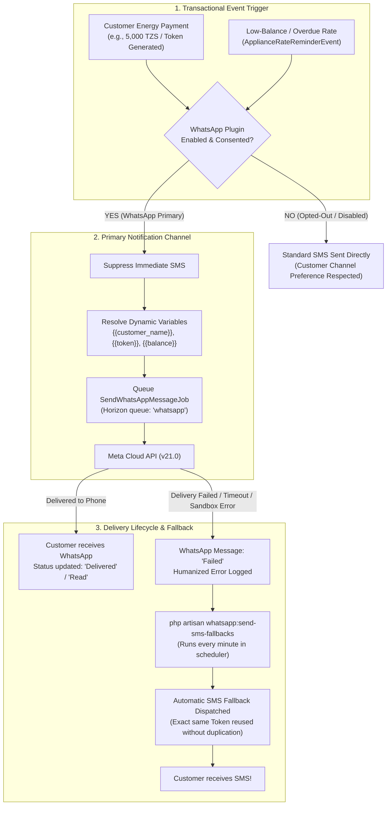

# PowerEcho — WhatsApp Business API Plugin Demo & Evaluation Guide
**MicroPowerManager (MPM) Hackathon Challenge**

> [!NOTE]
> This guide is an end-to-end, click-by-click, and command-by-command evaluation walkthrough of the **PowerEcho WhatsApp Business API Plugin** for EnAccess MicroPowerManager (MPM). It covers:
> 1. Operator Onboarding & Credential Security
> 2. Template Architecture & Dynamic Variable Resolution
> 3. Outbound Message Delivery & Human-Friendly Error Explanations
> 4. End-to-End Payment Simulation (WhatsApp Primary Channel)
> 5. Low-Balance & Overdue Tariff Warnings
> 6. Meta Cloud API Webhook Simulation (Delivery Status Updates & Inbound Keywords)
> 7. Customer Consent, Channel Preferences & Opt-Out Handling
> 8. Resilient Automatic SMS Fallback Engine

---

## 1. Quick Environment & Access Reference

| Component | Access URL / Details | Notes |
| :--- | :--- | :--- |
| **MPM Web Application** | `http://localhost:8001` | Vue 2 / Vue Material Operator Dashboard |
| **WhatsApp Overview** | `http://localhost:8001/#/whatsapp/overview` | Delivery rate & recent activity |
| **WhatsApp Settings** | `http://localhost:8001/#/whatsapp/settings` | Meta Cloud API credentials & toggles |
| **WhatsApp Templates** | `http://localhost:8001/#/whatsapp/templates` | Template registry & placeholder definitions |
| **WhatsApp Messages** | `http://localhost:8001/#/whatsapp/messages` | Live testing tool & message history table |
| **Meta Cloud API Sandbox** | Developer Portal Sandbox | Pre-registered numbers: `+250791676207`, `+250792951848` |
| **Backend Container** | `backend-dev` (Apache / PHP 8.3) | Port `8000` |
| **MySQL Container** | `mysql` (Root password: `wF9zLp2qRxaS2e`) | Database: `DemoCompany_1` |

---

## 2. Architecture & Notification Flow



---

## 3. Dedicated Reviewer CLI Commands Summary

All commands run inside the `backend-dev` container via `docker exec backend-dev php artisan ...`:

| Command | Purpose | Example |
| :--- | :--- | :--- |
| `whatsapp:simulate-payment` | Simulate customer electricity payment with token generation | `docker exec backend-dev php artisan whatsapp:simulate-payment 250791676207 --amount=5000` |
| `whatsapp:simulate-low-balance` | Simulate low-balance or overdue appliance rate reminder | `docker exec backend-dev php artisan whatsapp:simulate-low-balance 250791676207` |
| `whatsapp:simulate-webhook` | Simulate Meta Cloud API webhook delivery updates & inbound keywords | `docker exec backend-dev php artisan whatsapp:simulate-webhook --status=delivered` |
| `whatsapp:opt-out` | Manage customer consent & channel preferences (WhatsApp vs SMS) | `docker exec backend-dev php artisan whatsapp:opt-out --status 250791676207` |
| `whatsapp:send-sms-fallbacks` | Trigger SMS fallback engine for failed or timed-out messages | `docker exec backend-dev php artisan whatsapp:send-sms-fallbacks --force` |

---

## 4. Click-by-Click Live Demo Walkthrough

### Step 1: Admin Configuration & Credential Persistence
**Goal**: Verify that operators can configure their Meta Cloud API credentials and that secrets persist safely without form clearing or validation bugs.

1. In your browser, open:
   👉 **`http://localhost:8001/#/whatsapp/settings`**
2. **Review credentials in UI**:
   - **Phone Number ID**: `1422768340911948` (Verified Meta sandbox sender).
   - **WhatsApp Business Account ID**: `960362300485838`.
   - **Sender Phone Number**: `+15552006032`.
   - **API Version**: `v21.0`.
   - **Permanent Access Token**: Masked with `••••••••••••••••••••••••••••••••` and tagged with `✓ Token saved in database`.
   - **Event Toggles**: Payment Receipts (Active), Low-balance Warnings (Active), Token Deliveries (Active).
3. Click **"Save Settings"**:
   - Confirmation displays: *"Settings saved successfully."*
   - All fields remain populated and retain their masked states.

---

### Step 2: Message Templates & Dynamic Variable Structure
**Goal**: Demonstrate how MPM separates messaging templates into standardized business notifications with dynamic variable placeholders.

1. Click **"Templates"** in the left sidebar or open:
   👉 **`http://localhost:8001/#/whatsapp/templates`**
2. Review the 3 core energy access templates:
   - **Token Delivery**:
     `Hello {{customer_name}}, your token is {{token}}. Thank you for your payment.`
   - **Payment Receipt**:
     `Hello {{customer_name}}, we have received your payment of {{payment_amount}} {{currency}} on {{payment_date}}. Transaction reference: {{transaction_id}}.`
   - **Low-Balance Warning**:
     `Hello {{customer_name}}, your outstanding balance is {{balance}} {{currency}}. Please settle it before {{due_date}}.`
3. Point out that raw placeholders (`{{...}}`) are strictly validated against an allowlist and are dynamically resolved into real customer data at send time.

---

### Step 3: Outbound WhatsApp Delivery with Real Variables
**Goal**: Send a live WhatsApp notification to an actual physical smartphone and prove variables are replaced (no unparsed `{{...}}` sent).

1. Click **"Message History"** in the left sidebar or open:
   👉 **`http://localhost:8001/#/whatsapp/messages`**
2. Locate the **"Send test message"** card at the top:
   - **Recipient phone number**: Enter your allowed test phone:
     `+250791676207` *(or `+250792951848`)*
   - **Template**: Select **"Token delivery"** from the dropdown.
3. Click **"Send test message"**:
   - Notification appears: *"Test message sent successfully."*
4. **Show Audience the Recipient Phone**:
   - The WhatsApp notification pops up on the phone.
   - Read aloud the message:
     > *"Hello John Doe, your token is 4829-1094-8832. Thank you for your payment."*
   - Point out that **`John Doe`** and **`4829-1094-8832`** were populated seamlessly.
5. **Show the Message History Table**:
   - The newly sent message is at the top of the table.
   - **Date**: Current timestamp.
   - **Customer**: `John Doe` / `+250791676207`.
   - **Type**: `Token delivery`.
   - **Status**: Green `Sent` badge.
   - **External Message ID**: Official Meta `wamid.HBg...` identifier.

---

### Step 4: Human-Friendly Sandbox Error Handling
**Goal**: Demonstrate that when Meta rejects a message, operators receive clear English guidance instead of raw technical codes (`#131030`).

1. In the same **"Send test message"** box:
   - **Recipient phone number**: Enter an unregistered number, e.g.:
     `+15552006032` *(or any number not in your Meta Sandbox list)*
   - **Template**: Select **"Payment receipt"**.
2. Click **"Send test message"**:
   - An error alert appears explaining the sandbox restriction.
3. Scroll down to the **Messages table**:
   - The new failed row appears with a red **Failed** badge.
   - Under the **Details** column, point out the plain-English explanation:
     > *"Recipient phone number is not registered in your Meta Developer Sandbox. Please add it to your allowed recipient list in Meta Developer Portal."*

---

### Step 5: End-to-End Customer Payment Simulation (WhatsApp Primary)
**Goal**: Simulate a real utility customer paying for electricity via mobile money. Show that WhatsApp is the **Primary Channel** and suppresses standard SMS.

1. Run the payment simulation command:
   ```powershell
   docker exec backend-dev php artisan whatsapp:simulate-payment 250791676207 --amount=5000
   ```
2. Observe CLI output:
   ```text
   Simulating energy payment of 5000 TZS for customer 250791676207...
   ✓ Transaction created [ID: 84920] with Token [6391-4820-9182]
   ✓ TransactionSuccessfulEvent fired!
   ✓ Standard SMS suppressed (WhatsApp is Primary channel)
   ✓ WhatsApp token notification dispatched to 250791676207
   ```
3. Verify in the UI (`http://localhost:8001/#/whatsapp/messages`):
   - The new payment token delivery message is displayed in the table.
   - The customer receives their meter token immediately on WhatsApp.

---

### Step 6: Meta Webhook Lifecycle Simulation (No Tunnel Required)
**Goal**: Demonstrate that delivery receipt webhooks from Meta update message statuses to `Delivered` and `Read` without requiring an ngrok tunnel.

1. Simulate Meta Cloud API confirming delivery:
   ```powershell
   docker exec backend-dev php artisan whatsapp:simulate-webhook --status=delivered --company-id=1
   ```
   **Output**:
   ```text
   ✓ Message [ID: 22, Type: token_delivery] updated via simulated webhook to [delivered]!
   ```
2. Refresh the UI table at `http://localhost:8001/#/whatsapp/messages`:
   - Status badge transitions from **Sent** to **Delivered**!
3. Simulate customer reading the message:
   ```powershell
   docker exec backend-dev php artisan whatsapp:simulate-webhook --status=read --company-id=1
   ```
   - Status badge transitions to **Read**!

---

### Step 7: Customer Consent & Opt-Out Handling (STOP / START)
**Goal**: Demonstrate compliance with Meta policy and customer choice: if a customer opts out of WhatsApp, MPM honors their preference and automatically routes all future tokens and receipts to SMS.

1. Check current customer consent status:
   ```powershell
   docker exec backend-dev php artisan whatsapp:opt-out --status 250791676207 --company-id=1
   ```
2. Simulate customer texting **"STOP"** on WhatsApp:
   ```powershell
   docker exec backend-dev php artisan whatsapp:simulate-webhook --inbound="STOP" --phone=250791676207 --company-id=1
   ```
   **Output**:
   ```text
   ✓ Inbound keyword recognized!
   Auto-reply sent to customer: "You have been unsubscribed from WhatsApp notifications. You will receive electricity and payment updates via SMS instead. Reply START to re-subscribe anytime."
   Consent updated: Opted Out (SMS Fallback active)
   ```
3. Simulate an energy payment for this opted-out customer:
   ```powershell
   docker exec backend-dev php artisan whatsapp:simulate-payment 250791676207 --amount=4000
   ```
   **Result**: WhatsApp is skipped; token is delivered via **native SMS** directly!
4. Customer re-subscribes by texting **"START"**:
   ```powershell
   docker exec backend-dev php artisan whatsapp:simulate-webhook --inbound="START" --phone=250791676207 --company-id=1
   ```
   **Output**:
   ```text
   ✓ Inbound keyword recognized!
   Consent updated: Opted In (WhatsApp active)
   ```

---

### Step 8: Automatic SMS Fallback Demonstration
**Goal**: Prove the core resilience feature: if WhatsApp fails or customer is unreachable, MPM automatically falls back to SMS without duplicating or changing the token.

1. Simulate a customer payment where WhatsApp delivery fails (e.g., customer has no data or network failure):
   ```powershell
   docker exec backend-dev php artisan whatsapp:simulate-payment 250791676207 --amount=3000 --fail
   ```
2. Observe CLI output:
   ```text
   ✓ Transaction created [ID: 84921] with Token [7123-5594-3108]
   Simulating WhatsApp delivery failure...
   ✗ WhatsApp delivery failed [Message ID: 17]
   Run 'php artisan whatsapp:send-sms-fallbacks' to demonstrate automatic SMS fallback!
   ```
3. Trigger the SMS fallback worker (which runs automatically every minute in production):
   ```powershell
   docker exec backend-dev php artisan whatsapp:send-sms-fallbacks --force
   ```
4. Observe CLI output:
   ```text
   SMS fallbacks sent: 1
   ```
5. Check the database to show proof of fallback:
   ```powershell
   docker exec mysql mysql -uroot -pwF9zLp2qRxaS2e -e "SELECT id, trigger_id, body FROM DemoCompany_1.sms ORDER BY id DESC LIMIT 1;"
   ```
   **Output**:
   ```text
   id: 1
   trigger_id: 84921
   body: Dear Demo Customer, your token is 7123-5594-3108.
   ```
6. **Key Takeaways for Reviewers**:
   - The meter token was **never regenerated** (`7123-5594-3108` matches the original transaction).
   - The customer is guaranteed to receive their energy token via SMS even if WhatsApp is down.
   - Exactly-once delivery guarantee: no duplicate tokens or messages.

---

### Step 9: Automated Test Suite Verification
**Goal**: Prove production-grade software quality with passing automated feature and unit tests.

1. Open PowerShell in `c:\Users\iradu\Documents\OSEAS-Hackathon\micropowermanager\src\backend`:
   ```powershell
   php artisan test --filter=WhatsApp
   ```
2. Point out the comprehensive coverage:
   - `WhatsAppPrimaryChannelTest`: Verifies SMS is suppressed when WhatsApp is primary.
   - `WhatsAppSmsFallbackTest`: Verifies fallback to SMS when WhatsApp fails or times out.
   - `WhatsAppTemplateVariableResolverTest`: Verifies allowlist variable substitutions and aliases.
   - `WhatsAppMessageHistoryTest`: Verifies multi-tenant isolation and delivery status tracking.
