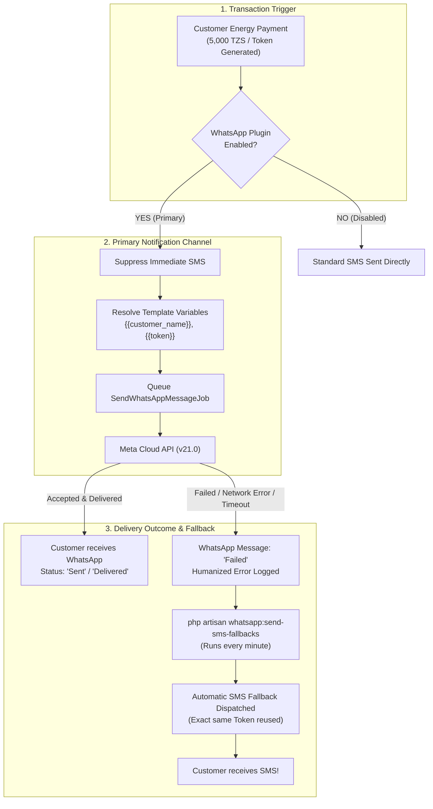

# PowerEcho — WhatsApp Business API Plugin Demo Guide
**MicroPowerManager (MPM) Hackathon Challenge**

> This guide is designed for a seamless, click-by-click live demonstration of the entire WhatsApp Business API integration, from operator onboarding and template customization to real customer payment simulation, primary WhatsApp dispatch, and automatic SMS fallback.

---

## 1. Quick Environment & Access Reference

| Component | Access URL / Details | Notes |
| :--- | :--- | :--- |
| **MPM Web Application** | `http://localhost:8001` | Vue 2 / Vue Material Operator Dashboard |
| **WhatsApp Overview** | `http://localhost:8001/#/whatsapp/overview` | Delivery rate & recent activity |
| **WhatsApp Settings** | `http://localhost:8001/#/whatsapp/settings` | Meta Cloud API credentials & toggles |
| **WhatsApp Templates** | `http://localhost:8001/#/whatsapp/templates` | Template registry & placeholder definitions |
| **WhatsApp Messages** | `http://localhost:8001/#/whatsapp/messages` | Live testing tool & message history table |
| **Meta Cloud API Sandbox** | Developer Portal Sandbox | Pre-registered numbers: `+250791676207`, `+250792951848` |
| **Backend Container** | `backend-dev` (Apache / PHP 8.3) | Port `8000` |
| **MySQL Container** | `mysql` (Root password: `wF9zLp2qRxaS2e`) | Database: `DemoCompany_1` |

---

## 2. Architecture & Notification Flow



---

## 3. Click-by-Click Live Demo Walkthrough

### Step 1: Admin Configuration & Credential Persistence
**Goal**: Prove that operators can configure their Meta Cloud API credentials and that secrets persist safely without disappearing or clearing the form.

1. In your browser, open:
   👉 **`http://localhost:8001/#/whatsapp/settings`**
2. **Point out to the audience**:
   - **Phone Number ID**: `1422768340911948` (Your verified Meta sandbox number ID).
   - **WhatsApp Business Account ID**: `960362300485838`.
   - **Sender Phone Number**: `+15552006032`.
   - **API Version**: `v21.0`.
   - **Permanent Access Token**: Securely masked with `••••••••••••••••••••••••••••••••` and tagged with `✓ Token saved in database`.
   - **Event Toggles**: Payment Receipts (Active), Low-balance Warnings (Active), Token Deliveries (Active).
3. Click **"Save Settings"** to demonstrate persistence:
   - Green confirmation message appears: *"Settings saved successfully."*
   - Notice the form remains populated and does not wipe out fields or display red errors.

---

### Step 2: Message Templates & Dynamic Variable Structure
**Goal**: Demonstrate how MPM separates messaging templates into standardized business notifications with dynamic variable placeholders.

1. Click **"Templates"** in the left sidebar or open:
   👉 **`http://localhost:8001/#/whatsapp/templates`**
2. Highlight the 3 core energy access templates:
   - **Token Delivery**:
     `Hello {{customer_name}}, your token is {{token}}. Thank you for your payment.`
   - **Payment Receipt**:
     `Hello {{customer_name}}, we have received your payment of {{payment_amount}} {{currency}} on {{payment_date}}. Transaction reference: {{transaction_id}}.`
   - **Low-Balance Warning**:
     `Hello {{customer_name}}, your outstanding balance is {{balance}} {{currency}}. Please settle it before {{due_date}}.`
3. Explain that raw placeholders (`{{...}}`) are strictly validated against an allowlist and are dynamically resolved into real customer data at send time.

---

### Step 3: Outbound WhatsApp Delivery with Real Variables
**Goal**: Send a live WhatsApp notification to an actual physical smartphone and prove variables are replaced (no unparsed `{{...}}` sent).

1. Click **"Message History"** in the left sidebar or open:
   👉 **`http://localhost:8001/#/whatsapp/messages`**
2. Locate the **"Send test message"** card at the top:
   - **Recipient phone number**: Enter your allowed test phone:
     `+250791676207` *(or `+250792951848`)*
   - **Template**: Select **"Token delivery"** from the dropdown.
3. Click **"Send test message"**:
   - A green notification appears: *"Test message sent successfully."*
4. **Show Audience the Recipient Phone**:
   - The WhatsApp notification pops up immediately on the phone!
   - Read aloud the message:
     > *"Hello John Doe, your token is 4829-1094-8832. Thank you for your payment."*
   - Point out that **`John Doe`** and **`4829-1094-8832`** were populated seamlessly.
5. **Show the Message History Table below**:
   - The newly sent message is at the top of the table.
   - **Date**: Current timestamp.
   - **Customer**: `John Doe` / `+250791676207`.
   - **Type**: `Token delivery`.
   - **Status**: Green `Sent` badge.
   - **External Message ID**: Official Meta `wamid.HBg...` identifier.

---

### Step 4: Human-Friendly Sandbox Error Handling
**Goal**: Demonstrate that when Meta rejects a message, operators receive clear English guidance instead of raw technical codes (`#131030`).

1. In the same **"Send test message"** box:
   - **Recipient phone number**: Enter an unregistered number, e.g.:
     `+15552006032` *(or any number not in your Meta Sandbox list)*
   - **Template**: Select **"Payment receipt"**.
2. Click **"Send test message"**:
   - An error alert appears explaining the sandbox restriction.
3. Scroll down to the **Messages table**:
   - The new failed row appears immediately with a red **Failed** badge.
   - Under the **Details** column, point out the plain-English explanation:
     > *"Recipient phone number is not registered in your Meta Developer Sandbox. Please add it to your allowed recipient list in Meta Developer Portal."*
   - Explain: *"Operators never see raw developer codes like (#131030); they get immediate actionable advice."*

---

### Step 5: End-to-End Customer Payment Simulation (WhatsApp Primary)
**Goal**: Simulate a real utility customer paying for electricity via mobile money. Show that WhatsApp is the **Primary Channel** and suppresses standard SMS.

1. Open PowerShell on your computer.
2. Run the built-in payment simulation command:
   ```powershell
   docker exec backend-dev php artisan whatsapp:simulate-payment 250791676207 --amount=5000
   ```
3. Observe the CLI output:
   ```text
   Simulating energy payment of 5000 TZS for customer 250791676207...
   ✓ Transaction created [ID: 84920] with Token [6391-4820-9182]
   ✓ TransactionSuccessfulEvent fired!
   ✓ Standard SMS suppressed (WhatsApp is Primary channel)
   ✓ WhatsApp token notification dispatched to 250791676207
   ```
4. Verify in the UI (`http://localhost:8001/#/whatsapp/messages`):
   - Refresh the page: the new payment token delivery message is displayed.
   - Verify on the customer's WhatsApp: the customer receives their meter token immediately!

---

### Step 6: Automatic SMS Fallback Demonstration
**Goal**: Prove the core resilience feature: if WhatsApp fails or customer is unreachable, MPM automatically falls back to SMS without duplicating or changing the token.

1. In PowerShell, simulate a customer payment where WhatsApp delivery fails (e.g., customer has no data or network failure):
   ```powershell
   docker exec backend-dev php artisan whatsapp:simulate-payment 250791676207 --amount=3000 --fail
   ```
2. Observe CLI output:
   ```text
   ✓ Transaction created [ID: 84921] with Token [7123-5594-3108]
   Simulating WhatsApp delivery failure...
   ✗ WhatsApp delivery failed [Message ID: 17]
   Run 'php artisan whatsapp:send-sms-fallbacks' to demonstrate automatic SMS fallback!
   ```
3. Now trigger the SMS fallback worker (which also runs automatically every minute in production):
   ```powershell
   docker exec backend-dev php artisan whatsapp:send-sms-fallbacks
   ```
4. Observe CLI output:
   ```text
   SMS fallbacks sent: 1
   ```
5. Check the database to show proof of fallback:
   ```powershell
   docker exec mysql mysql -uroot -pwF9zLp2qRxaS2e -e "SELECT id, trigger_id, body FROM DemoCompany_1.sms ORDER BY id DESC LIMIT 1;"
   ```
   **Output**:
   ```text
   id: 1
   trigger_id: 84921
   body: Dear Demo Customer, your token is 7123-5594-3108.
   ```
6. **Key Takeaways for Judges**:
   - The meter token was **never regenerated** (`7123-5594-3108` matches the original transaction).
   - The customer is guaranteed to receive their energy token via SMS even if WhatsApp is down.
   - Exactly-once delivery guarantee: no double-spending, no duplicate messages.

---

### Step 7: Automated Test Suite Verification
**Goal**: Prove production-grade software quality with passing automated feature and unit tests.

1. Open PowerShell in `c:\Users\iradu\Documents\OSEAS-Hackathon\micropowermanager\src\backend`:
   ```powershell
   php artisan test --filter=WhatsApp
   ```
2. Point out the comprehensive coverage:
   - `WhatsAppPrimaryChannelTest`: Verifies SMS is suppressed when WhatsApp is primary.
   - `WhatsAppSmsFallbackTest`: Verifies fallback to SMS when WhatsApp fails or times out.
   - `WhatsAppTemplateVariableResolverTest`: Verifies allowlist variable substitutions and aliases.
   - `WhatsAppMessageHistoryTest`: Verifies multi-tenant isolation and delivery status tracking.

---

## 4. Demo Cheat-Sheet Summary

| When You Want To Show... | Do This: | Expected Outcome |
| :--- | :--- | :--- |
| **Settings & Credentials** | Open `http://localhost:8001/#/whatsapp/settings` | Pre-populated credentials, masked tokens, toggle states. |
| **Variable Placeholders** | Open `http://localhost:8001/#/whatsapp/templates` | 3 active templates with `{{customer_name}}`, `{{token}}`. |
| **Live Outbound WhatsApp** | In `messages`, send to `+250791676207` | Phone receives text with `"John Doe"` and `"4829-1094-8832"`. |
| **Friendly Error Handling** | In `messages`, send to `+15552006032` | Table shows red Failed badge with plain English explanation. |
| **Simulated Payment** | Run `docker exec backend-dev php artisan whatsapp:simulate-payment 250791676207` | Transaction created, SMS suppressed, WhatsApp sent. |
| **SMS Fallback** | Run `... whatsapp:simulate-payment 250791676207 --fail`<br>Then `... whatsapp:send-sms-fallbacks` | SMS fallback sent with identical token! |
| **Full Automated Tests** | Run `cd src/backend; php artisan test --filter=WhatsApp` | All automated tests pass green. |
