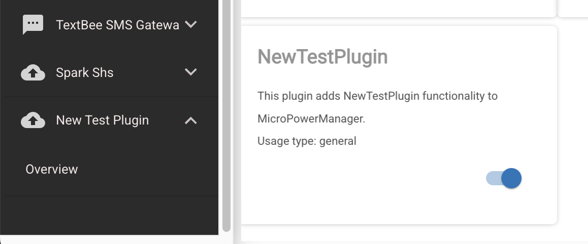
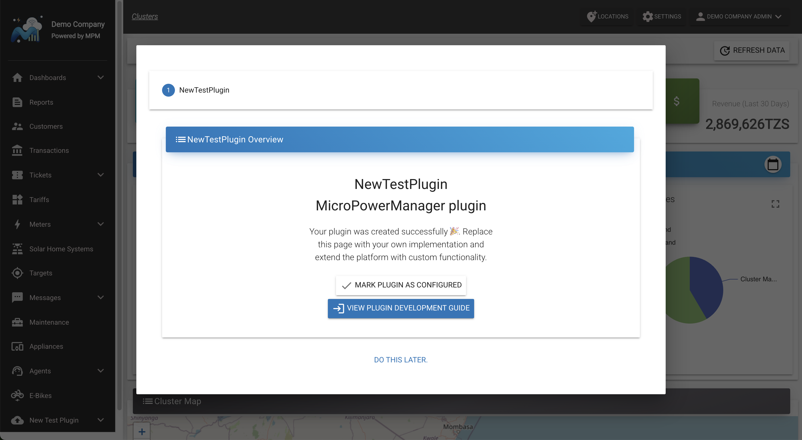

# Plugin Development Guide

This guide will walk you through the process of creating and
integrating a plugin for MicroPowerManager (MPM).

## Overview

Plugins are modular components that extend MPM's functionality.
Each plugin consists of:

- Backend package (`src/backend/app/Plugins/{plugin-name}`)
- Frontend module (`src/frontend/src/plugins/{plugin-name}`)

## Quick Start

1. **Prerequisites**
   - Running [advanced development environment](development-environment.md#advanced-development-environment) with local PHP installation
   - Basic knowledge of Laravel and Vue.js

2. **Create Plugin Template**

   From the root directory of MicroPowerManager in your local development environment, run the following command:

   ```bash
   cd src/backend
   php artisan micropowermanager:new-plugin {plugin-name}
   ```

   Replace `{plugin-name}` with the desired name of your plugin.

   This command:
   - Creates plugin backend code `src/backend/app/Plugins/{plugin-name}`
   - Creates plugin frontend code `src/frontend/src/plugins/{plugin-name}`
   - Creates a plugin documentation page `docs/integrations-guide/{docs-category}/{plugin-name}.md` with placeholder content
   - Adds a case for the plugin to the plugin catalog `App\Enums\MpmPlugin`
   - Automatically performs basic plugin registration (for example in frontend routes and the registration tail in `main.js`)

   The docs category is guessed from the plugin name, for example a name containing `money` ends up in `payment-provider` and one containing `sms` in `communication`.
   A name that matches no keyword ends up in `manufacturer` as this is the most common type of plugin.
   Pass `--docs-category={docs-category}` to choose the folder yourself.

   The frontmatter fields of the documentation page are described in the [docs README](https://github.com/EnAccess/micropowermanager/blob/main/docs/README.md#plugin-frontmatter).

3. **Post-Creation Setup**
   - Review generated code structure
   - Fill in the generated documentation page
   - Follow integration steps below

4. **Example Plugins**
   Check existing plugins for reference:
   - Payment providers (e.g., Calin, Vodacom)
   - Meter manufacturers (e.g., SteamaCo, Spark)
   - SHS manufacturers (e.g., SunKingSHS, Spark SHS)
   - Feature plugins (e.g., Asset Management)

## Integration Steps

The following steps describe how your plugin is integrated with MicroPowerManager.

Most of the fundamental boilerplate setup is handled automatically when you run the `artisan micropowermanager:new-plugin` command.
We won’t go into those generated details here as you can always inspect the changes using git diff to understand what was created behind the scenes.

This guide focuses on the custom integration steps required to extend and connect your plugin to the system.

### Backend Integration

The backend integration process involves several key steps to make your plugin discoverable and functional within MicroPowerManager.

#### The Plugin Catalog

All plugins are cataloged in the string-backed enum `App\Enums\MpmPlugin`.
The case value is the plugin's slug in snake_case, for example `your_plugin`.
Tenants, devices, API clients and the frontend all refer to a plugin by this slug.

The generator adds the case for you, so no central migration is needed to add a plugin.
Each case is described by the enum's methods, which need an arm for your plugin:

- `displayName()` is the name shown in the UI.
- `description()` is the text shown in the plugin settings.
- `usageType()` is the usage type the plugin is meant for, or `general`.
- `isPaymentProvider()` flags payment provider plugins.

`installationCommand()` is derived from the slug, with `_` replaced by `-` and `:install` appended, for example `your-plugin:install`.

```php
// src/backend/app/Enums/MpmPlugin.php

enum MpmPlugin: string {
    // ...other plugins
    case YourPlugin = 'your_plugin';
}
```

#### Register API Routes

Plugins use their own API resolver to manage authorization instead of the standard JWT-based middleware,
which is also how they can expose genuinely public endpoints — a public payment page, an inbound webhook — that still resolve to the correct tenant without a JWT.
Register your plugin's URL prefix in `App\Services\ApiResolvers\ThirdPartyApiResolverService`, and
implement `App\Services\Interfaces\IApiResolver` to say how a company id is resolved for that prefix (from a path segment, a hash token, or a JWT where one is actually present):

```php
// src/backend/app/Services/ApiResolvers/ThirdPartyApiResolverService.php

class ThirdPartyApiResolverService {
    // ...other API constants
    public const YOUR_PLUGIN_API = 'api/your-plugin/';

    private const array RESOLVERS = [
        // ...other resolvers
        self::YOUR_PLUGIN_API => YourPluginApiResolver::class,
    ];
}
```

```php
// src/backend/app/Services/ApiResolvers/YourPluginApiResolver.php

class YourPluginApiResolver implements IApiResolver {
    public function resolveCompanyId(Request $request): int {
    }
}
```

#### Database Setup

Your plugin will/might need several database migrations to integrate with MPM:

##### Create Plugin Tables

If your plugin needs to create database tables, the migrations should be placed in the `database/migrations` folder.

The recommended way to create a migration is by using the following command:

```sh
php artisan make:migration-tenant create_your_plugin_table
```

This ensures the migration is generated with the correct configuration for the multi-tenant environment used by MPM.

#### Customise Installation Command

The package generation command already creates a basic plugin installation command.

This command is executed when a user enables your plugin for the first time via the plugin settings menu.

If your plugin requires additional one-time configuration, such as

- creating default credentials
- performing initial setup tasks

you can adapt and customize the installation command accordingly.

```php
<?php
namespace App\Plugins\NewTestPlugin\Console\Commands;

use Illuminate\Console\Command;

class InstallPackage extends Command
{
    protected $signature = 'new-test-plugin:install';
    protected $description = 'Install NewTestPlugin Package';

    public function __construct() {
        parent::__construct();
    }

    public function handle(): void
    {
        $this->info('Installing NewTestPlugin Integration Package\n');

        // Here you can add plugin initialisation code.
        // For example creating initial plugin credentials in the database
        // or registering a Manufacurer with MicroPowerManager.

        $this->info('Package installed successfully..');
    }
}
```

#### Scheduled Commands

A scheduled command of your plugin should only do its work for tenants that have the plugin enabled.
Use the `App\Traits\ScheduledPluginCommand` trait and check the plugin's status first:

```php
if (!$this->checkForPluginStatusIsActive(MpmPlugin::YourPlugin)) {
    return;
}
```

#### Vending Plugins

Every device is vended by one plugin, whose slug is stored in `devices.vending_plugin`.
By default this is the plugin of the device's manufacturer, and users can move a device to another vending plugin from its detail page.

A plugin that issues tokens has its service provider name the plugin's `MpmPlugin` case and the class that issues its tokens.
That class implements `App\Lib\ITokenIssuer`.

Both are declared by `App\Lib\IVendingPluginProvider`, through `mpmPlugin(): MpmPlugin` and `tokenIssuer()`.
A manufacturer plugin's service provider implements `App\Lib\IManufacturerPluginProvider`, which extends it:

```php
// Providers/YourPluginServiceProvider.php
class YourPluginServiceProvider extends ServiceProvider implements IManufacturerPluginProvider {
    public function mpmPlugin(): MpmPlugin {
        return MpmPlugin::YourPlugin;
    }

    public function tokenIssuer(): string {
        return YourPluginApi::class;
    }
}
```

The manufacturer it registers takes the short class name of the token issuer as its `api_name` (here `YourPluginApi`).
That is how MPM finds the manufacturer's API and the default vending plugin for its devices.

A plugin that vends devices made by others implements `App\Lib\IVendingPluginProvider` instead, and it is offered for any device once it is enabled.
Its API is handed every device a user moves to it, so it has to refuse devices it cannot vend.

A device is vended only while its vending plugin is enabled.
A payment for a device whose vending plugin is disabled fails with that reason.

#### Payment Provider Plugins

If your plugin is a **payment provider** (processes transactions from an external payment gateway), there are additional integration steps required:

1. **Flag the plugin as a payment provider**

   Return `true` for your plugin in `MpmPlugin::isPaymentProvider()`.

   ```php
   public function isPaymentProvider(): bool {
       return match ($this) {
           // ...other providers
           self::YourPaymentProvider => true,
           default => false,
       };
   }
   ```

   If your provider only **receives** payments through gateway callbacks (inbound only), this is all that is needed.
   If it also supports **initiating** payments from MPM, continue with the next steps.

2. **Implement the `PaymentInitiator` interface**

   Your plugin's transaction service must implement `App\Services\Interfaces\PaymentInitiator`. This enforces a consistent `initiatePayment()` method that creates the provider-specific record and an associated `Transaction` entry.

   ```php
   use App\Services\Interfaces\PaymentInitiator;

   class YourProviderTransactionService implements PaymentInitiator {
       public function initiatePayment(
           float $amount,
           string $sender,
           string $message,
           string $type,
           int $customerId,
           ?string $serialId = null,
       ): array {
           // 1. Create your provider-specific transaction record
           // 2. Create the associated Transaction record
           // 3. Call your provider's API if needed (e.g. to get a redirect URL)
           // 4. Return ['transaction' => $transaction, 'provider_data' => [...]]
       }
   }
   ```

3. **Register in the `PaymentInitiationProvider` enum**

   Add a case to the string-backed `App\Enums\PaymentInitiationProvider` enum and map it to your transaction service in `initiatorClass()`.
   Its values are `cash`, `third_party` and the slugs of the payment provider plugins, so the case value is your plugin's slug.
   This is required for your provider to appear as an available payment option in the UI.
   Give the case a short docblock with the provider's display name — this enum is rendered in the public API documentation.

   ```php
   enum PaymentInitiationProvider: string {
       // ...other providers
       /** Your Provider */
       case YourProvider = MpmPlugin::YourPaymentProvider->value;

       public function initiatorClass(): string {
           return match ($this) {
               // ...other providers
               self::YourProvider => YourProviderTransactionService::class,
           };
       }
   }
   ```

4. **Provider validation**

   Payment validation (device ownership, minimum purchase amounts) is handled via the `ITransactionProvider::validateRequest()` interface and `AbstractPaymentAggregatorTransactionService::validatePaymentOwner()`. If your provider receives incoming payment callbacks, implement `ITransactionProvider` in your provider class to plug into the existing validation pipeline.

### Frontend Integration

This section describe how to integrate your plugin with the MicroPowerManager frontend.

#### Add Plugin Routes

The package generation command creates a default Overview page and registers a frontend route, making your plugin accessible and visible in the application sidebar.



If your plugin requires a more complex routing or sidebar structure, you can modify your plugin’s section in `ExportedRoutes.js` accordingly.
The sidebar icon can also be customized in this file to better match your plugin’s functionality or branding.

```js
// src/frontend/src/ExportedRoutes.js

import YourPluginOverview from "./plugins/your-plugin/modules/Overview/Overview"

export const exportedRoutes = [
  // ...other routes
  {
    path: "/your-plugin",
    component: ChildRouteWrapper,
    meta: {
      sidebar: {
        enabled_by_mpm_plugin: "your_plugin", // Your plugin's slug from MpmPlugin
        name: "Your Plugin",
        icon: "plugin-icon", // Choose an appropriate icon
      },
    },
    children: [
      {
        path: "your-plugin-overview",
        component: YourPluginOverview,
        meta: {
          layout: "default",
          sidebar: {
            enabled: true,
            name: "Overview",
          },
        },
      },
      // Add more routes as needed
    ],
  },
]
```

#### Customising the Registration Tail

The Registration Trail is displayed after each login once your plugin has been enabled by a user.
Its purpose is to indicate that additional configuration steps may still be required.

The component shown in the trail is configured by registering a global component under your plugin's slug in `main.js`.

By default, the package generation command registers the plugin’s overview page.



However, in most cases you will want to replace this with something more meaningful.
For example a configuration screen or credentials setup page to guide users through the remaining setup steps.

```js
// src/frontend/src/main.js

import YourPluginsOtherComponent from "@/plugins/your-plugin/modules/Overview/SomeOtherComponent"

Vue.component("your_plugin", YourPluginsOtherComponent)
```

#### Closing the RegistrationTail

To signal to the application that the user has completed the registration process, emit an event with your plugin's slug to the shared `EventBus`.

Once this event is received, the Registration Trail will be closed and will no longer be shown on subsequent logins.

```js
import { EventBus } from "@/shared/eventbus.js"

EventBus.$emit("your_plugin")
```

## Advanced configurations

> [!WARNING]
> This section needs expansion.

- Add plugin pages to Role-based access control (RBAC)
- Creating external endpoints and using access keys

## Testing Your Plugin

1. Install the plugin:

   ```bash
   php artisan your-plugin:install
   ```

   or enable the plugin via the Settings UI.

2. Verify database setup:
   - Check migrations ran successfully
   - Verify tables were created
   - Ensure the plugin is listed in the plugin settings

3. Check frontend integration:
   - Plugin appears in sidebar
   - Routes are accessible
   - Components render correctly

## Best Practices

1. **Code Organization**
   - Keep your plugin self-contained as much as possible
   - Follow the established directory structure for consistency
   - Use the MPM core services when appropriate to maintain integration

2. **Testing**
   - Test all features thoroughly
   - Verify database operations
   - Check frontend functionality

3. Document your plugin's features and configuration requirements

4. Use proper versioning for your plugin package

Remember to check existing plugins for reference implementations that might help guide your development.
