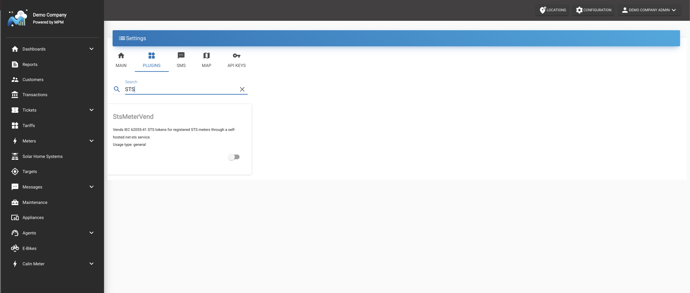
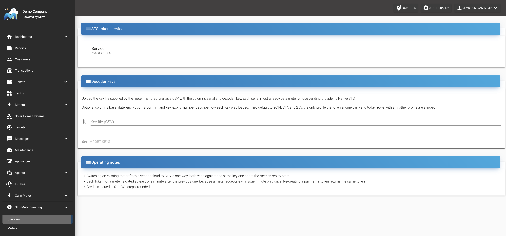
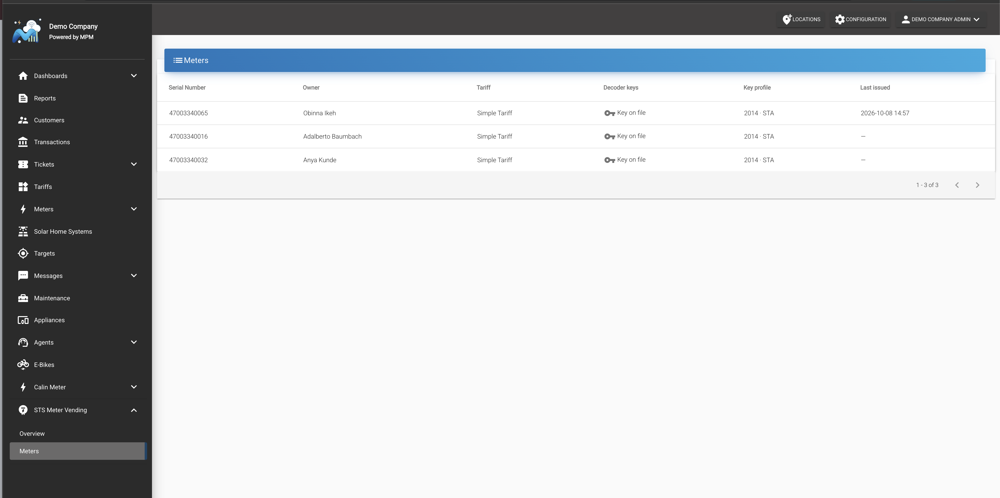

# STS Meter Vending

This guide explains how to vend STS tokens for prepaid meters directly from MicroPowerManager, without the meter manufacturer's cloud.

## Overview

The **StsMeterVend** plugin generates STS tokens for a meter once the meter's decoder key is imported.
Importing the key makes STS the meter's vending provider, whichever manufacturer made it.
Meters without an imported key keep vending through their manufacturer.

| Manufacturer           | Status |
| ---------------------- | ------ |
| **Calin Meters**       | ✅     |
| **Calin Smart Meters** | ✅     |

### Pre-requisites

1. The STS token engine is set up for your installation, see [STS Token Engine (nxt-sts)](../../installation/sts-token-engine.md).
2. The decoder key of each meter, supplied by the meter manufacturer.

### Integration

1. Enable the `StsMeterVend` plugin under **Settings** → **Configuration** → **Plugins**.

   

2. Open **STS Meter Vending** → **Overview**, check that the **STS token service** card shows **Connected** (click **Check connection** to test it again), then click **Import keys** and choose the decoder key file.
   Download the sample key file on that page for the expected columns.
   If the file lists meters that are not registered in MicroPowerManager yet, a pop-up offers to register them: choose their manufacturer and tariff, and their keys are imported with them.

   

3. Check **STS Meter Vending** → **Meters**: each meter should show **Device Mapping** as **Mapped**, meaning its decoder key is recorded and it is ready to vend.
   The meter's **Manufacturer Control** card now shows **Vending Provider** set to StsMeterVend, and **Verify device mapping** checks that the key is still recorded.

   

Payments and **Manufacturer Control** → **Generate Token** now vend through STS.

> [!INFO]
> Only keys loaded with base date **2014**, algorithm **STA** and key expiry **255** can be vended today.
> Other keys are skipped on import with a reason.

## Good to know

- Credit is issued in 0.1 kWh steps, rounded up, with at most 1638.3 kWh per token.
- Each token for a meter is dated at least one minute after the previous one, and re-creating a payment's token returns the same token.
- To hand a meter back to its manufacturer, use **Change Vending Provider** in **Manufacturer Control** and pick the manufacturer's provider.
  Check first that the manufacturer's cloud can still vend the meter: its STS token history stays with STS.
  Picking StsMeterVend again, or importing the key again, moves it back to STS.
- StsMeterVend is offered as a vending provider for every device once it is enabled, but it only vends meters whose decoder key is on file.
- Disabling the plugin moves all its meters back to their manufacturer's provider.
  Their keys stay on file, so re-enabling the plugin and importing the key file again moves them back to STS.

## Troubleshooting

| Message                                 | What to do                                                                                     |
| --------------------------------------- | ---------------------------------------------------------------------------------------------- |
| `STS_API_URL is not configured.`        | The token engine is not set up, see the [setup guide](../../installation/sts-token-engine.md). |
| `STS service unreachable: …`            | The token engine is down; ask whoever runs your installation to check it.                      |
| `No decoder key on file for meter …`    | Import the meter's key (step 2).                                                               |
| `No meter registered with this serial.` | Import the file again and register the missing meters in the pop-up.                           |
| `Not a meter.`                          | The serial belongs to another kind of device; STS keys only apply to meters.                   |
| `STS vends meters only; device …`       | Pick the device's manufacturer as its vending provider in **Manufacturer Control**.            |

## References

- [nxt-sts on GitHub](https://github.com/nxtgrid/nxt-sts)
- [STS Association](https://www.sts.org.za/)
