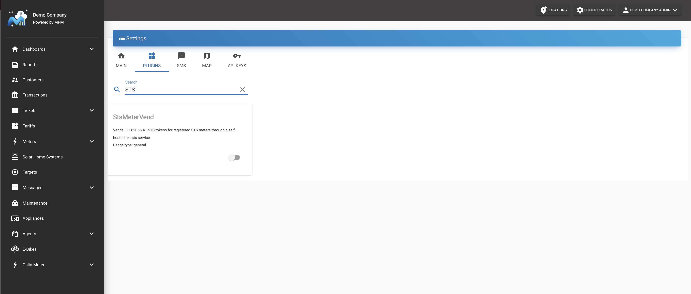
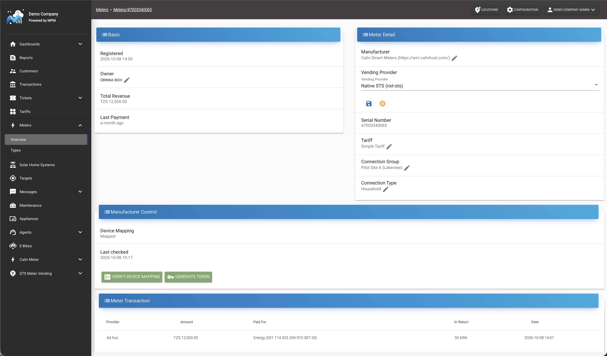
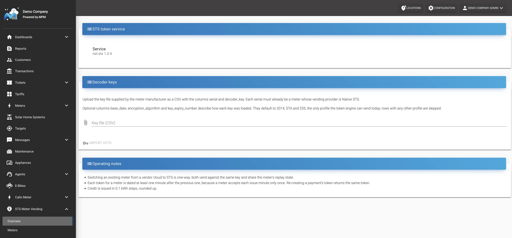
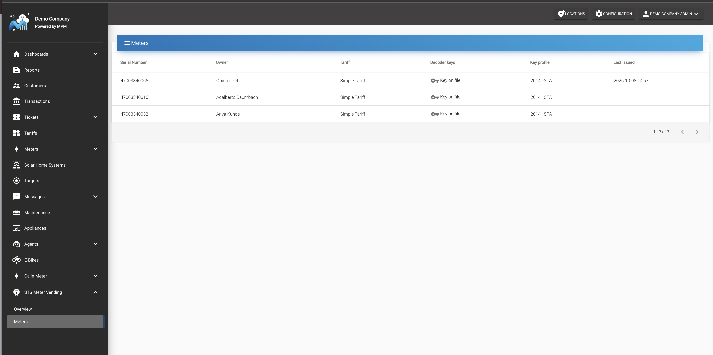

# STS Meter Vending

This guide explains how to vend STS tokens for prepaid meters directly from MicroPowerManager, without the meter manufacturer's cloud.

## Overview

The **StsMeterVend** plugin generates STS tokens for a meter once its **Vending Provider** is set to **Native STS (nxt-sts)**.
Meters without a vending provider keep vending through their manufacturer.

| Manufacturer           | Status |
| ---------------------- | ------ |
| **Calin Meters**       | ✅     |
| **Calin Smart Meters** | ✅     |

### Pre-requisites

1. The STS token engine is set up for your installation, see [STS Token Engine (nxt-sts)](../installation/sts-token-engine.md).
2. The decoder key of each meter, supplied by the meter manufacturer.
3. The meters registered under **Calin Meters** or **Calin Smart Meters**.

### Integration

1. Enable the `StsMeterVend` plugin under **Settings** → **Configuration** → **Plugins**.

   

2. Open the meter under **Meters**, set **Vending Provider** to **Native STS (nxt-sts)** in the **Meter Detail** card and save.
   To set it for many meters at once, import them under **Settings** → **Configuration** → **Import** → **Devices** with `"vending_provider": "native_sts"`.

   

3. Open **STS Meter Vending** → **Overview**, check that the **STS token service** shows a version, then upload the decoder key file and click **Import keys**.
   Download the sample key file on that page for the expected columns.

   

4. Check **STS Meter Vending** → **Meters**: each meter should show **Key on file**.

   

Payments and **Manufacturer Control** → **Generate Token** now vend through Native STS.

> [!INFO]
> Only keys loaded with base date **2014**, algorithm **STA** and key expiry **255** can be vended today.
> Other keys are skipped on import with a reason.

## Good to know

- Credit is issued in 0.1 kWh steps, rounded up, with at most 1638.3 kWh per token.
- Each token for a meter is dated at least one minute after the previous one, and re-creating a payment's token returns the same token.
- Moving a meter from its manufacturer's cloud to Native STS is one-way.
- When the plugin is disabled, meters with a decoder key stop vending, and meters without one vend through their manufacturer again.

## Troubleshooting

| Message                                     | What to do                                                                                  |
| ------------------------------------------- | ------------------------------------------------------------------------------------------- |
| `STS_API_URL is not configured.`            | The token engine is not set up, see the [setup guide](../installation/sts-token-engine.md). |
| `STS service unreachable: …`                | The token engine is down; ask whoever runs your installation to check it.                   |
| `No decoder key on file for meter …`        | Import the meter's key (step 3).                                                            |
| `Meter is not vended through Native STS; …` | Set the meter's vending provider (step 2), then import the key again.                       |

## References

- [nxt-sts on GitHub](https://github.com/nxtgrid/nxt-sts)
- [STS Association](https://www.sts.org.za/)
