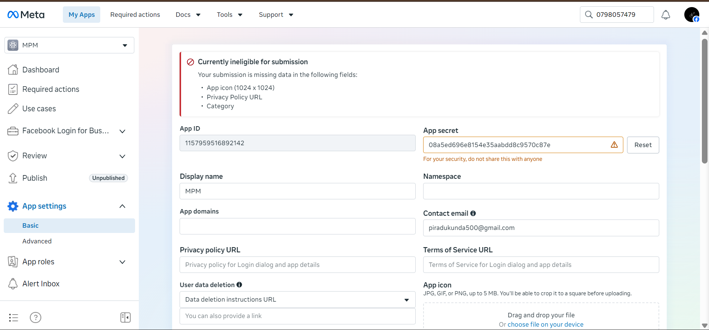
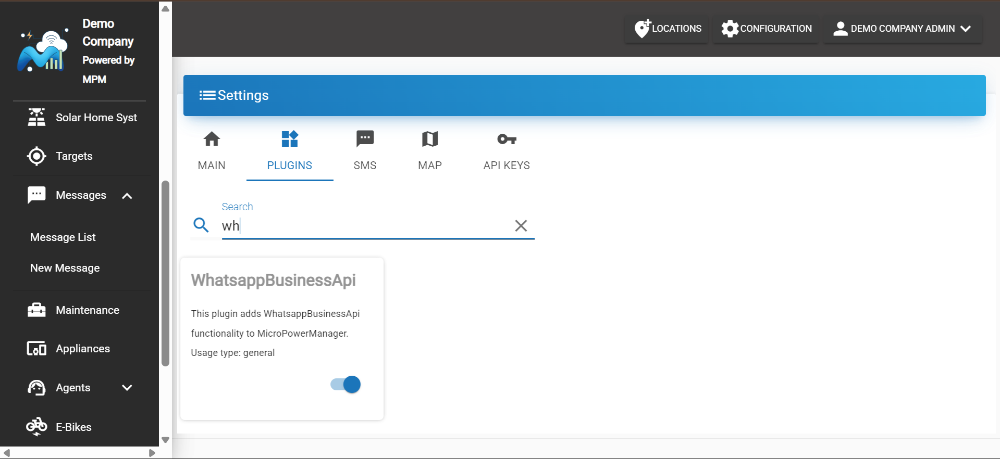
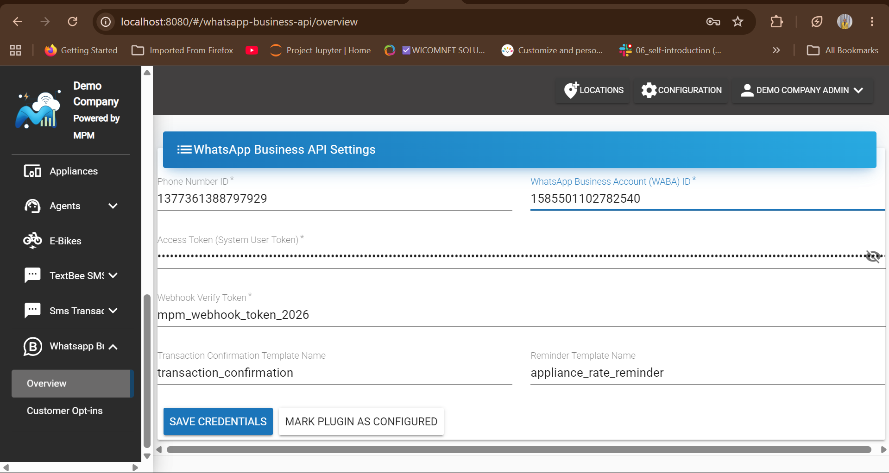
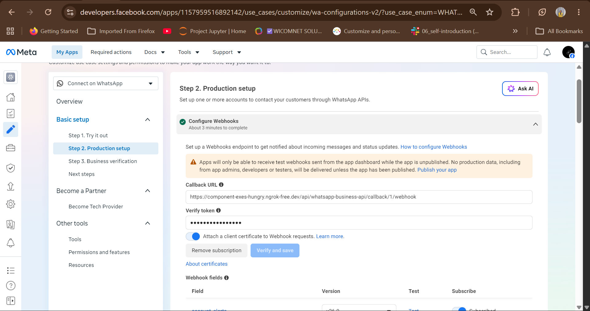
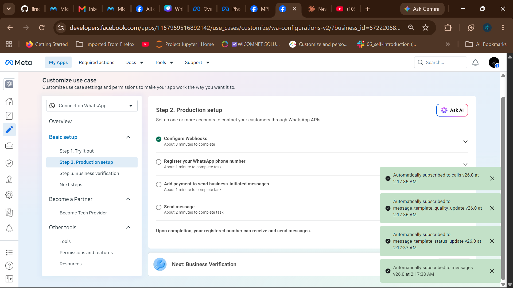
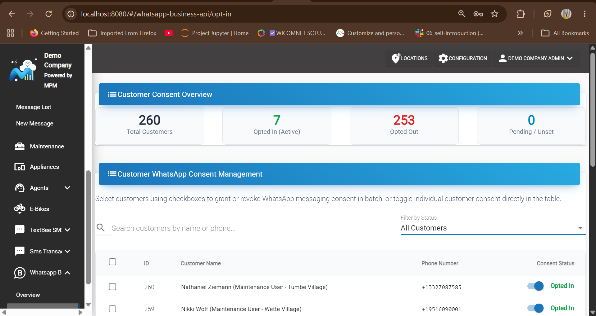
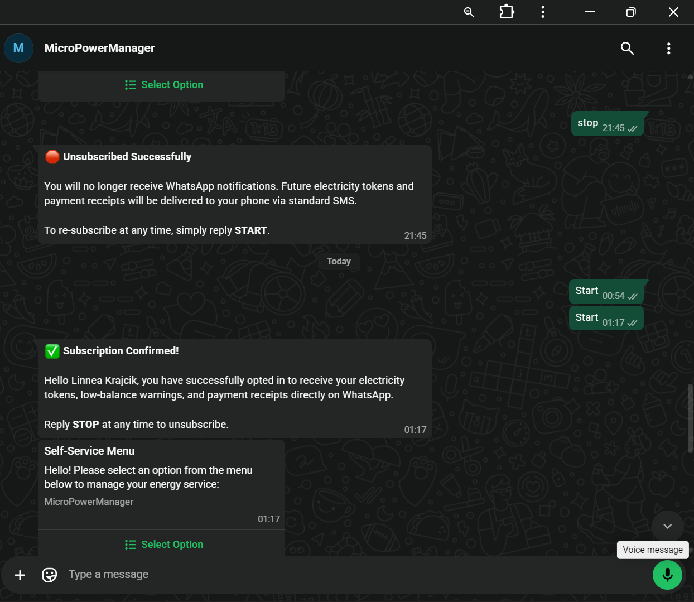
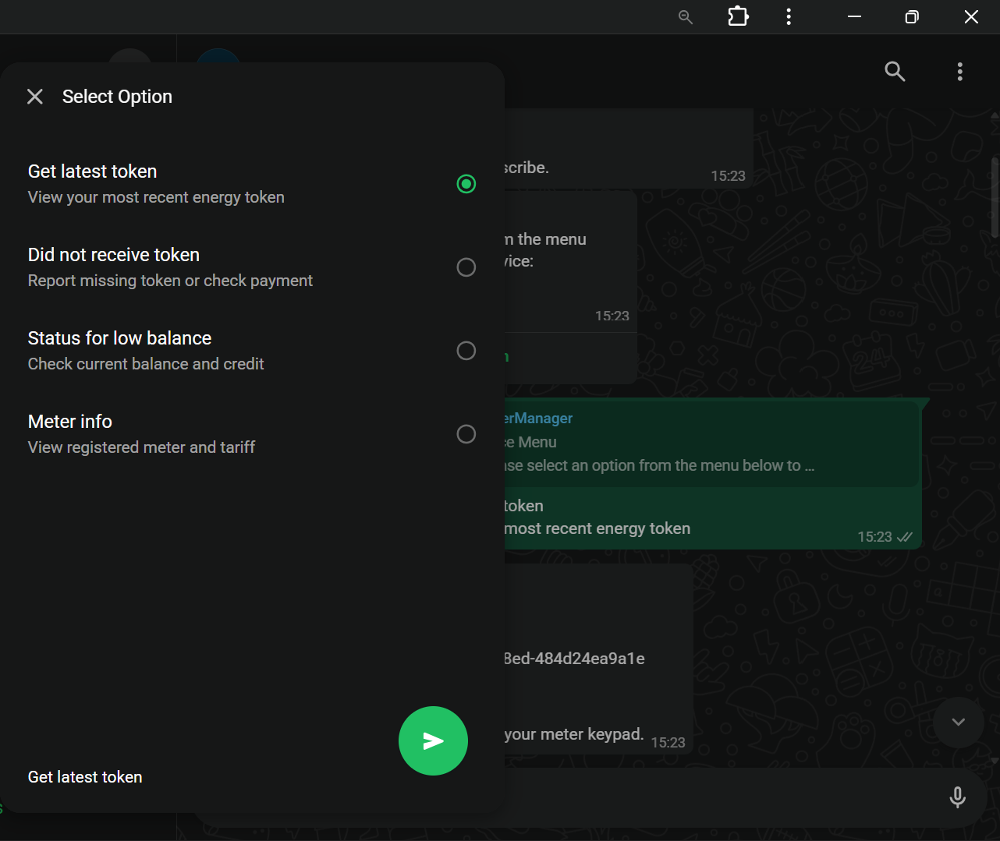
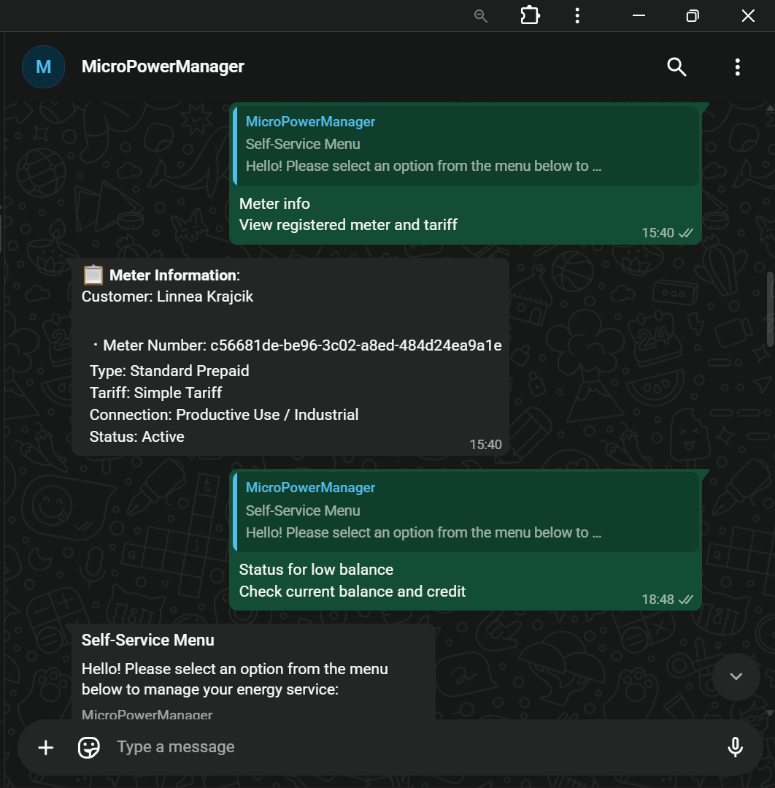
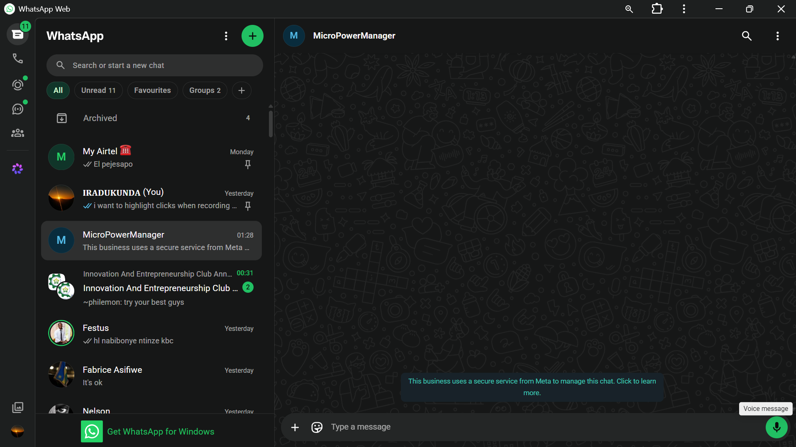

# WhatsApp Business API

> [!TIP]
> **Complete Illustrated PDF Manual Available**: A publication-grade 13-page configuration and operational guide with screenshots and customer workflows is available for offline distribution:
> [Download MicroPowerManager_WhatsApp_Plugin_Guide.pdf](MicroPowerManager_WhatsApp_Plugin_Guide.pdf)

The WhatsApp Business API plugin enables MicroPowerManager (MPM) to deliver transactional notifications — payment confirmations, energy token deliveries, failed transaction alerts, and overdue appliance rate reminders — directly over the Meta WhatsApp Business Cloud API.

Across the primary operating markets MPM serves (sub-Saharan Africa, South and Southeast Asia), WhatsApp is the primary daily communication channel for rural and peri-urban utility customers. By prioritizing WhatsApp as the primary notification channel, energy utilities achieve significantly lower per-message operating costs, higher delivery rates, real-time message receipts (`sent`, `delivered`, `read`), and interactive 24/7 self-service menus — with an automatic, robust **two-tier fallback to cellular SMS** whenever a customer is offline or undeliverable.

---

## Key Features

- **Transactional Notification Delivery**: Dispatches electricity tokens, payment receipts, and appliance financing reminders using pre-approved Meta message templates with dynamic parameter binding (`{{1}}`, `{{2}}`).
- **Automated Two-Tier Cellular SMS Fallback**: If WhatsApp credentials are unconfigured, a recipient has not opted in, or Meta reports message delivery failure (`failed` status callback), notifications automatically re-route through your secondary cellular SMS gateway (e.g. TextBee, Africa's Talking). Customers never miss their power tokens.
- **Inbound Interactive Self-Service Bot**: Customers can query their latest token, report missing tokens (auto-escalating to high-priority MPM support tickets), check meter credit balance, and inspect registered meter details via WhatsApp interactive list menus.
- **Failed Transaction Alerts**: Automatically notifies customers via WhatsApp when energy purchases or appliance payments fail (e.g. invalid meter number, payment gateway timeout), guiding them with actionable retry instructions before falling back to SMS.
- **Granular Multi-Customer Opt-In & Compliance Management**: Built-in consent registry adhering to Meta's strict business messaging policies. Features an onboarding checkbox hook, live search, status filters, individual toggle switches, and batch multi-customer selection with an action banner.
- **Self-Healing Phone Number Sync**: Detects Meta number change events (`system.new_wa_id`) and inbound customer update commands (e.g. `UPDATE NUMBER +255...`, `BADILI NAMBA +255...`), keeping MPM customer records and WhatsApp profiles automatically in sync.
- **Enterprise HMAC-SHA256 Webhook Security**: Validates the cryptographic `X-Hub-Signature-256` HTTP header on all incoming webhooks using constant-time hash comparison (`hash_equals`) to prevent spoofing and replay attacks.
- **Unified SMS & WhatsApp Conversation Hub (`/sms`)**: Support teams view unified customer conversation threads displaying official monochrome WhatsApp Business outline logos, standard SMS badges, theme-adherent message bubbles, and bidirectional messaging within Meta's 24-hour customer service window.

---

## Prerequisites

1. **Access to MPM Admin Panel** with `Owner` or `Admin` privileges.
2. **Meta Developer Account**: Registered at [developers.facebook.com](https://developers.facebook.com/).
3. **WhatsApp Business Account (WABA)** with a verified business phone number.
4. **Meta System User Access Token**: Generated with `whatsapp_business_messaging` and `whatsapp_business_management` permissions.
5. **Meta WhatsApp Cloud Phone Number ID** and **WABA ID**.
6. **Meta App Secret**: Found in your Meta Developer App Settings (used for `X-Hub-Signature-256` HMAC validation).
7. **Pre-approved WhatsApp Message Templates** created in Meta Business Manager.
8. **Configured Secondary SMS Gateway** (e.g. TextBee, Africa's Talking) for two-tier reliability fallback.

---

## Step 1: Create Meta Cloud API App & Retrieve Credentials

1. Log into the [Meta for Developers Portal](https://developers.facebook.com/) and click **My Apps** → **Create App**.
2. Select **Business** as the app type and enter your app name and contact email.
3. On the App Dashboard, locate **WhatsApp** in the Add Products list and click **Set up**.
4. Navigate to **WhatsApp** → **API Setup** in the left sidebar:
   - Note your temporary access token, **Phone Number ID**, and **WhatsApp Business Account ID (WABA ID)**.
   - Send a test message to your personal WhatsApp number to verify connectivity.
5. Navigate to **App Settings** → **Basic**:
   - Locate the **App Secret** field. Click **Show** and copy your App Secret. You will provide this in MPM to enforce `X-Hub-Signature-256` payload verification.
6. Create a **Permanent System User Access Token**:
   - Go to [Meta Business Manager](https://business.facebook.com/) → **Business Settings** → **Users** → **System Users**.
   - Create an admin system user (e.g. `mpm-whatsapp-service`).
   - Assign the WhatsApp App and grant `whatsapp_business_messaging` and `whatsapp_business_management` permissions.
   - Click **Generate New Token** and copy the permanent access token.



---

## Step 2: Configure WhatsApp Templates in Meta

Meta requires pre-approved templates for outbound utility notifications sent outside the 24-hour customer service window. In Meta Business Manager, navigate to **WhatsApp Manager** → **Account tools** → **Message templates** and create the following:

### 1. Transaction Confirmation / Energy Token Delivery Template
- **Template Name**: `transaction_confirmation` (or your chosen identifier)
- **Category**: `UTILITY`
- **Language**: `en` (or your local operational language)
- **Sample Body**:
  ```text
  Dear customer, your payment of {{1}} has been received. Your electricity token is {{2}}. Thank you for using our service!
  ```
  *(Dynamic Parameters: `{{1}}` = transaction amount with currency, `{{2}}` = 20-digit meter electricity token)*

### 2. Appliance Rate / Payment Reminder Template
- **Template Name**: `appliance_rate_reminder`
- **Category**: `UTILITY`
- **Language**: `en`
- **Sample Body**:
  ```text
  Dear customer, your appliance installment of {{1}} is due on {{2}}. Please make your payment on time to avoid service interruption.
  ```
  *(Dynamic Parameters: `{{1}}` = remaining installment balance with currency, `{{2}}` = payment due date)*

### 3. Failed Transaction Notification Template
- **Template Name**: `transaction_failed_alert`
- **Category**: `UTILITY`
- **Language**: `en`
- **Sample Body**:
  ```text
  Dear customer, your payment of {{1}} on {{2}} could not be processed. Reason: {{3}}. Please verify your meter number or contact customer support.
  ```

---

## Step 3: Enable the Plugin in MPM

1. Log into your MicroPowerManager administration portal.
2. In the left navigation menu, navigate to **Settings** → **Plugins**.
3. Locate **WhatsApp Business API** in the available plugins directory.
4. Toggle the switch to **Enable** the plugin.



---

## Step 4: Configure Credentials & Templates in MPM

1. In the MPM sidebar, click on **WhatsApp Business API** → **Overview**.
2. Complete the configuration form with your Meta credentials:
   - **Phone Number ID**: Your Meta WhatsApp Phone Number ID from Step 1.
   - **WhatsApp Business Account ID**: Your WABA ID from Step 1.
   - **Access Token (System User Token)**: Your permanent Meta System User Access Token.
   - **Webhook Verify Token**: A secure random string (e.g. `mpm_webhook_token_2026`) used to verify incoming webhook challenges from Meta.
   - **Meta App Secret (for X-Hub-Signature-256)**: The App Secret copied from Meta App Settings in Step 1. MPM uses this to cryptographically authenticate every incoming webhook payload.
   - **Transaction Confirmation Template Name**: The exact name of your token delivery template in Meta (e.g. `transaction_confirmation`).
   - **Reminder Template Name**: The exact name of your appliance reminder template in Meta (e.g. `appliance_rate_reminder`).
3. Click **Save**. The plugin immediately validates your configuration.



---

## Step 5: Configure Meta Webhooks & Security

To receive real-time delivery receipts (`sent`, `delivered`, `read`), incoming customer queries, and interactive bot selections:

1. In the Meta for Developers Portal, navigate to **WhatsApp** → **Configuration** (or **Webhooks**).
2. Click **Edit** under **Webhook**.
3. Set the **Callback URL** using the standard MPM webhook pattern:
   ```text
   https://<your-mpm-domain>/api/whatsapp-business-api/callback/<company-id>/webhook
   ```

   ### Understanding the Callback URL Components:
   | Component | Description | Local Development (ngrok) | Production Deployment |
   | :--- | :--- | :--- | :--- |
   | **Protocol** | Must be `https://` (Meta rejects unencrypted HTTP) | `https://` | `https://` |
   | **Host / Domain** | Public domain of your server | `xxxx.ngrok-free.app` *(via `ngrok http 8000`)* | `mpm.yourdomain.com` |
   | **Plugin API Route** | Fixed MicroPowerManager route | `/api/whatsapp-business-api/` | `/api/whatsapp-business-api/` |
   | **Callback Endpoint** | Company identifier + endpoint | `callback/1/webhook` | `callback/1/webhook` |

   > [!TIP]
   > - **What is `<company-id>`?**: It is the numeric ID of your organization/mini-grid in MicroPowerManager. In standard single-tenant setups, this is `1`.
   > - **Local Development Example (with ngrok)**:  
   >   If your ngrok terminal displays `Forwarding: https://1a2b-3c4d.ngrok-free.app -> http://localhost:8000`, your Callback URL is:  
   >   `https://1a2b-3c4d.ngrok-free.app/api/whatsapp-business-api/callback/1/webhook`
   > - **Production Example (with live SSL domain)**:  
   >   If your MPM server runs at `https://energy.example.com`, your Callback URL is:  
   >   `https://energy.example.com/api/whatsapp-business-api/callback/1/webhook`

4. Set the **Verify Token** to the exact **Webhook Verify Token** entered in MPM Overview (e.g. `mpm_webhook_token_2026`).

> [!CAUTION]
> **Crucial Meta Setting — Client Certificate Toggle**:
> In the Meta Webhook configuration modal, make sure that the toggle switch **"Attach a client certificate to Webhook requests"** is **TURNED OFF (Grey)**.
> If this switch is accidentally left ON (Blue), Meta attempts Mutual TLS (mTLS) client certificate negotiation. Because standard web servers and ngrok tunnels do not terminate mTLS client certificates, Meta's webhook proxy (`WBxP`) will immediately fail with error:
> `The callback URL or verify token couldn't be validated. (#N/A:WBxP-1483198068-4275553709)`.

5. Click **Verify and Save**.  
   MPM features an optimized challenge responder that validates Meta's `hub.challenge` in under 50ms, comfortably satisfying Meta's strict 5-second challenge verification timeout window.



6. Under **Webhook fields**, click **Manage** and subscribe to:
   - **`messages`**: Delivers incoming customer messages, bot interactions, and delivery receipts (`delivered`, `read`).
   - **`message_template_status_update`**: Alerts MPM when message templates are approved or modified in Meta.
7. Click **Done** / **Save**.



### Cryptographic Webhook Security (`X-Hub-Signature-256`)

To prevent spoofing, replay attacks, and man-in-the-middle payload tampering, MicroPowerManager cryptographically validates all incoming webhook events using the `X-Hub-Signature-256` HTTP header:

- **Verify Token vs. App Secret**:
  - **Webhook Verify Token** (e.g. `mpm_webhook_token_2026`): Configured in MPM Overview and Meta Webhook setup; used solely for `GET` verification challenges.
  - **Meta App Secret** (`WHATSAPP_APP_SECRET`): The secret key found in [Meta for Developers](https://developers.facebook.com/) under **App Settings** → **Basic** → **App Secret**. Meta uses this private key to sign all `POST` webhook payloads.
- **HMAC-SHA256 Verification**: Every event payload is hashed using `hash_hmac('sha256', $rawPayload, $appSecret)`.
- **Timing-Safe Evaluation**: The calculated hash is compared against the received `sha256=<signature>` header using PHP's constant-time `hash_equals()` to thwart timing attacks.
- **Strict Enforcement**: If the signature header is invalid or missing when `WHATSAPP_APP_SECRET` is set, MPM rejects the request with `401 Unauthorized` and logs a security event.

---

## Step 6: Select WhatsApp as Your Primary Messaging Gateway

To begin sending notifications over WhatsApp:

1. Navigate to **Settings** → **Configuration** → **Main Settings** in the MPM sidebar.
2. Scroll to the **SMS Gateway** dropdown field.
3. Select **WhatsApp Business API Gateway** as your primary gateway.
4. Ensure that a secondary SMS gateway (such as **TextBee SMS Gateway** or **Africa's Talking**) is configured and accessible.
5. Click **Save**.

MPM will now attempt WhatsApp delivery first for all opted-in customers, automatically falling back to your secondary SMS gateway when appropriate.

---

## Customer Opt-Ins and Consent Management

Meta strictly mandates explicit customer opt-in before businesses send outbound notifications. MicroPowerManager provides granular, manual opt-in controls to ensure telecommunications compliance without blanket automation.

### 1. Direct Opt-In During Customer Registration
When field agents or operators register a new customer in MPM (**Clients** → **Add Customer**):
- An explicit **WhatsApp Opt-In** checkbox is available on the registration form:
  *`Opt-in to WhatsApp messaging (Send electricity tokens and alerts via WhatsApp)`*
- Enabling this checkbox immediately records verified consent in the database upon customer creation, allowing instant token delivery over WhatsApp from their very first energy purchase.

### 2. Manual Multi-Customer Selection & Batch Management
In **WhatsApp Business API** → **Customer Opt-ins**, operators have full manual control over customer consent:
- **No Blanket Automatic Opt-In**: Bulk operations are intentional and manual. You select specific customers rather than blindly altering all records across the company.
- **Interactive Checkbox Selection**: Every row in the customer list contains a checkbox. You can manually check off individual customers or use the table header checkbox to select all visible records on the current page.
- **Batch Actions Bar**:
  When 1 or more customers are selected, a green action banner displays:
  - **`Opt-in Selected (X)`**: Grants WhatsApp messaging consent for only the selected customers.
  - **`Opt-out Selected (X)`**: Revokes WhatsApp messaging consent for only the selected customers (falling back to SMS).
  - **`Deselect All`**: Resets the current selection.
- **Confirmation Safety Dialog**: Shows a summary modal with the exact count of affected customers before executing the update.

### 3. Real-Time Search, Filters, and Unified Inline Status Toggles
- **Real-Time Search**: Search customers by name, surname, or phone number with instant debounced filtering.
- **Status Filter**: Filter the customer directory by status (*All Customers*, *Opted In Only*, *Opted Out Only*, *Pending / Not Set*).
- **Clean Unified Status Switch**: Each customer row features an integrated toggle switch clearly indicating their live consent state (`Opted In` or `Opted Out`). Clicking the switch immediately persists the update in the database without any modal.
- **Live Statistics Overview**: The overview cards (*Total Customers*, *Opted In*, *Opted Out*, *Pending*) automatically re-calculate and display updated counts in real time.



### 4. Inbound Customer Opt-In & Opt-Out Commands
Customers can directly manage their messaging preference from WhatsApp on their own phones:
- **Opt-Out Keywords**: Texting `STOP`, `OPTOUT`, `CANCEL`, or `END` immediately marks the customer as opted-out in MPM, delivers an opt-out confirmation, and ensures all subsequent energy tokens route over cellular SMS.
- **Opt-In Keywords**: Texting `START`, `OPTIN`, or `YES` re-activates WhatsApp messaging consent, confirms subscription, and delivers the interactive self-service menu.



---

## Automated Self-Service & Inbound Interactive Menus

When a customer messages the utility over WhatsApp with greeting or unspecified words (such as `"hi"`, `"hello"`, `"help"`, `"good morning"`, `"menu"`), the plugin automatically delivers an interactive template message containing a menu page with quick-action buttons:

```
┌──────────────────────────────────────────────┐
│ ⚡ Self-Service Menu                         │
│                                              │
│ Hello! Please select an option from the      │
│ menu below to manage your energy service:    │
│                                              │
│ ┌──────────────────────────────────────────┐ │
│ │            [Select Option]               │ │
│ └──────────────────────────────────────────┘ │
│                                              │
│ MicroPowerManager                            │
└──────────────────────────────────────────────┘
```

When tapped, WhatsApp opens a page with 4 self-service buttons:

1. **Get latest token** (`btn_latest_token`): Looks up the customer's account and returns their most recent energy token code, units (`kWh`), meter serial number, and timestamp.
2. **Did not receive token** (`btn_not_received_token`): Searches recent payments. If a token was generated, it immediately re-sends the token. If the payment is pending or token generation failed, it automatically opens an escalated Support Ticket in MPM and gives the customer the ticket ID.
3. **Status for low balance** (`btn_low_balance`): Checks the customer's meter consumption record (`credit_on_meter`). If credit is $\le 5.0\text{ kWh}$, it issues an urgent low-balance warning; otherwise, it confirms balance is sufficient and power is active.
4. **Meter info** (`btn_meter_info`): Returns complete meter information including serial number, tariff type, connection phase, and active status.



Customers can also trigger any of these 4 actions directly by typing the natural phrase (e.g. *"latest token"*, *"did not recieve token"*, *"status for low balance"*, *"meter info"*) or entering numbers `1`, `2`, `3`, or `4`. Every outbound bot reply is also recorded in MPM's SMS conversations table (`direction = 1`, `gateway_id = 33`), ensuring support agents have full visibility in the customer conversation thread.



---

## Two-Tier Reliability & SMS Fallback Architecture

To ensure critical electricity tokens are never lost even if a customer has no mobile internet, the plugin implements a comprehensive two-tier fallback architecture:

```
                                [Send Notification]
                                         │
                             Is WhatsApp Primary Gateway?
                                         │
                           ┌─────────────┴─────────────┐
                          Yes                          No
                           │                           │
                 Is Customer Opted In?            [Send via SMS]
                           │
                   ┌───────┴───────┐
                  Yes              No ──────┐
                   │                        │
          [Send WhatsApp]                   │
                   │                        │
            Delivery Status?                │
             ┌─────┴─────┐                  │
        Delivered      Failed ──────────────┼───────► [Automatic Fallback]
                                            │         Send via SMS Gateway
                                            │         (TextBee, Africa's Talking)
```

1. **Tier 1 (Synchronous Guard / Pre-dispatch Fallback)**:
   - If WhatsApp credentials are not configured, the customer has not opted in, or the Meta API returns an immediate error (HTTP 4xx/5xx), `SmsSender::sendSms()` catches the exception and immediately invokes the secondary SMS gateway (`TextbeeSmsGateway`, `AfricasTalking`, etc.).
2. **Tier 2 (Asynchronous Webhook Guard / Delivery Failure Fallback)**:
   - If Meta accepts the message initially (`200 OK`) but subsequent webhooks report `failed` (e.g. recipient phone offline, SIM swapped, or account inactive), `WhatsappWebhookController::handleStatusUpdate()` triggers the fallback gateway to ensure the customer receives their electricity token over standard cellular GSM.

---

## Failed Transaction Notifications

When an electricity token purchase or appliance payment fails in MicroPowerManager (e.g. meter communication error, invalid serial number, provider timeout, or insufficient balance):

1. **Automatic Event Capture**: MPM dispatches a `TransactionFailedEvent`, captured by the `TransactionFailedWhatsappListener`.
2. **Opt-In Verification**: If the customer has opted in to WhatsApp messaging, MPM prepares a dedicated failure notification.
3. **Actionable Customer Guidance**: The customer receives an immediate WhatsApp alert containing:
   - The transaction amount and date.
   - The specific reason for failure (e.g. *Invalid Meter Number* or *Payment Gateway Timeout*).
   - Clear instructions on how to retry or contact utility support.
4. **SMS Gateway Fallback**: If the customer has not opted in or their phone is offline, the alert is automatically re-routed through the configured cellular SMS gateway.

---

## Operator Operations Guide

### 1. Unified Conversation History (`/sms`)
- Navigate to **Messaging / SMS** in the left navigation sidebar.
- Every WhatsApp message exchanged with customers is seamlessly visible in the conversation stream:
  - **WhatsApp messages** display the official monochrome WhatsApp outline logo next to the message time and recipient.
  - **Cellular SMS messages** display the standard `<md-icon>sms</md-icon>` icon.
  - Incoming customer inquiries appear in soft red/pink bubbles (`#ffebee`).
  - Outgoing notifications and bot replies appear in light blue bubbles (`#e2f3fd`).
- Operators can filter conversations by phone number or customer name to trace all transactional tokens, low-balance warnings, bot menu interactions, and manual agent replies.



### 2. Replying to Customers from the Dashboard
- Support agents can click on any customer conversation and enter a message in the compose box.
- When sent, MPM uses Meta Cloud API's free-form messaging interface within the open 24-hour customer service window.
- If the 24-hour window has expired or the customer's phone is offline, the message is automatically delivered via the fallback SMS gateway.

### 3. Managing Bot-Escalated Missing Token Tickets
- When a customer clicks **Did not receive token** and no recent completed token is found, the plugin automatically creates a high-priority ticket in **Tickets** → **Open Tickets**.
- The ticket title contains `Missing Token Report: <Customer Phone>`.
- The ticket body contains the customer's phone number and the last transaction ID/amount.
- Operators can investigate the payment provider gateway (e.g. Vodacom M-Pesa, Airtel Money, Wave), resolve the token issue, and close the ticket, notifying the customer directly in the thread.

---

## Customer Quick Reference Guide

Give your customers these guidelines so they can self-serve 24/7 without needing to call support:

| Action | How Customer Does It | What Customer Receives |
|---|---|---|
| **Open Menu** | Text anything (*"hi"*, *"hello"*, *"help"*, *"menu"*) | Interactive WhatsApp menu with **[Select Option]** button opening the 4 choices |
| **Get Latest Token** | Tap button or text *"latest token"*, *"to get latest token"*, or `1` | Token code (e.g. `4455-6677-8899`), units (`kWh`), meter serial, and date |
| **Missing Token** | Tap button or text *"did not recieve token"*, *"no token"*, or `2` | Instant re-send of completed token, or ticket confirmation `#123` with support alert |
| **Check Balance** | Tap button or text *"status for low balance"*, *"balance"*, or `3` | Current credit on meter (`kWh`) and low-balance recharge alert if $\le 5.0\text{ kWh}$ |
| **Meter Info** | Tap button or text *"meter info"*, *"my meter"*, or `4` | Meter serial number, tariff name, connection phase, and active status |
| **Update Phone** | Text `UPDATE NUMBER +255...` or `BADILI NAMBA +255...` | Automated confirmation and automatic synchronization of registered phone |
| **Opt Out of WhatsApp** | Text `STOP`, `OPTOUT`, or `CANCEL` | Confirmation of opt-out; future tokens delivered via standard SMS |
| **Re-subscribe** | Text `START`, `OPTIN`, or `YES` | Confirmation of subscription and delivery of the self-service menu |

---

## Troubleshooting

| Symptom / Error | Root Cause | Solution |
|---|---|---|
| **`Callback URL or verify token couldn't be validated (#N/A:WBxP-...)`** | **"Attach a client certificate to Webhook requests"** is toggled ON (blue) in Meta Developer Portal. | **Turn the switch OFF (grey)**. Standard ngrok tunnels and web servers do not use mutual TLS client certificates; leaving it on causes Meta's webhook proxy to fail. |
| **`Webhook verification timeout (>5s)`** | ngrok is pointing to the frontend port (`8080`) instead of the backend port (`8000`). | Restart ngrok pointing to your Laravel backend: `ngrok http 8000`. MPM features an ultra-fast challenge responder that responds in <50ms. |
| **`Webhook verification failed (403)`** | Verify token mismatch between Meta and MPM Overview. | Ensure the token in Meta webhook settings matches the **Webhook Verify Token** in MPM Overview (e.g. `mpm_webhook_token_2026`). |
| **`Webhook signature verification failed (401)`** | Missing, tampered, or mismatched `X-Hub-Signature-256` header. | Verify the **Meta App Secret** in MPM Overview matches the App Secret in Meta Dashboard (**App Settings** → **Basic**) and requests are not being stripped of headers by reverse proxies. |
| **`Customer has not opted in`** | The recipient's `opted_in` flag is false or unrecorded. | Navigate to **WhatsApp Business API** → **Customer Opt-ins** and enable opt-in for the customer, or enable WhatsApp Opt-In during customer registration. |
| **`Template not found or disapproved`** | Template name or language code does not match Meta. | Confirm the template is approved in Meta Business Manager and names match exactly in MPM Overview. |
| **`Transaction failed notification not delivered via WhatsApp`** | Customer is not opted in or phone number lacks international country code (+E.164). | Verify customer is opted in under **Customer Opt-ins**. If not opted in, the notification automatically falls back to cellular SMS. |
| **`Token delivery delayed`** | Recipient has no internet connection. | The webhook will flag failure upon timeout, and the SMS fallback will deliver the token over GSM. |
