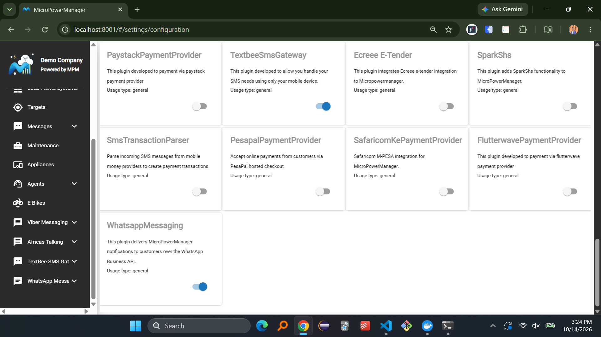
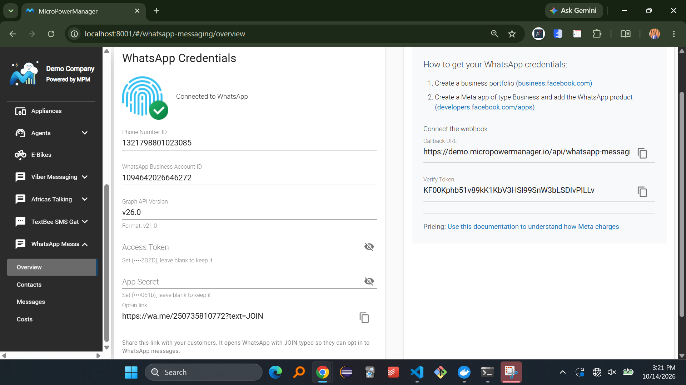
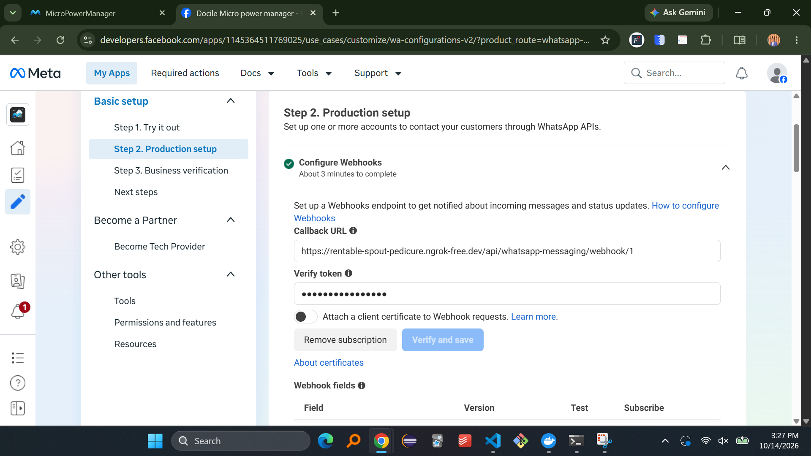

# WhatsApp Messaging

The WhatsApp Messaging plugin delivers MicroPowerManager notifications, such as payment receipts and appliance reminders, to customers over the WhatsApp Business Platform (Cloud API) from Meta.
WhatsApp is tried first and SMS stays the fallback: customers who have not opted in, and any message WhatsApp cannot deliver, still go out through your configured SMS gateway.
Customers can also use WhatsApp to request their last token or appliance balance themselves.

For how operators and customers use the plugin day to day, see the [WhatsApp usage guide](../usage-guide/whatsapp.md).

## Prerequisites

- Access to the MPM admin panel
- A configured SMS gateway ([AfricasTalking](africastalking.md) or [TextBee](textbee.md)), which WhatsApp falls back to
- A Facebook account to sign in to Meta
- A phone number for your business that is not already registered on the WhatsApp or WhatsApp Business app
- A payment method in Meta Business Manager, since Meta charges for business-initiated messages

## Step 1: Create a Business Portfolio

1. Visit [business.facebook.com](https://business.facebook.com) and sign in with your Facebook account
2. Click **Create a business portfolio**
3. Enter your business name, your name and your business email address
4. Confirm your email address

## Step 2: Create a Meta App

1. Visit [developers.facebook.com/apps](https://developers.facebook.com/apps)
2. Click **Create App**
3. Choose the **use cases**
4. Select the business portfolio from Step 1
5. Follow the WhatsApp onboarding to add and verify your business phone number

## Step 3: Collect Your Credentials

MPM needs five values from Meta:

| MPM field                        | Where to find it in Meta                                                                                                                                                                   |
| -------------------------------- | ------------------------------------------------------------------------------------------------------------------------------------------------------------------------------------------ |
| **Phone Number ID**              | App dashboard → **Productions set up** → **Send message**                                                                                                                                               |
| **WhatsApp Business Account ID** | App dashboard → **Productions set up** → **Send message**                                                                                                                   |
| **Graph API Version**            | App dashboard → **App Settings** → **Advanced**, for example `v26.0`                                                                                                                    |
| **Access Token**                 | App dashboard → **Productions set up** → **Send message**  |
| **App Secret**                   | App dashboard → **App Settings** → **Basic**                                                                                                 |

## Step 4: Enable the WhatsApp Plugin in MPM

1. Log into your MPM admin panel
2. Navigate to **Settings** → **Plugins**
3. Find the **WhatsappMessaging** plugin in the list
4. Toggle the switch to **Enable** the plugin

## Step 5: Configure WhatsApp Credentials

1. Click **WhatsApp Messaging** in the sidebar
2. Click **Overview** to open the configuration page
3. Enter the values from Step 3:
   - **Phone Number ID**
   - **WhatsApp Business Account ID**
   - **Graph API Version**
   - **Access Token**
   - **App Secret**
4. Click **Save**

MPM verifies the credentials with Meta before saving them.
When the check succeeds, the status changes to **Connected to WhatsApp** and the opt-in link appears.

Saved secrets are never shown again.
The page only shows their last four characters, and you can leave the field blank to keep the saved value.

### Message Templates

Meta only allows a business to start a conversation with an approved message template.
When you save the credentials, MPM submits each of its notification texts (the texts under **Settings** → **Configuration** → **Sms**) to Meta as a template.

Within 24 hours of a customer's last message, MPM sends notifications as normal text and no template is needed.
Outside that window, the notification needs its approved template.

Meta reviews new templates, which usually takes a few minutes but can take up to a day.
Until a template is approved, that notification goes out by SMS.
If Meta rejects a template, the Overview page lists it after saving, and that notification keeps going out by SMS.

## Step 6: Connect the Webhook

The webhook lets MPM receive customer replies, opt-ins and delivery statuses from Meta.

1. In MPM, open **WhatsApp Messaging** → **Overview** and copy the **Callback URL** and **Verify Token** from the setup guide on the right
2. In the Meta app dashboard, open **WhatsApp** → **Production set up**
3. Under **Configure webhooks**
4. Paste the **Callback URL** and **Verify Token** and click **Verify and save**
5. Under **Webhook fields**, subscribe to **messages**

The Callback URL has the form `https://your-mpm-domain/api/whatsapp-messaging/webhook/{company-id}`.

## Step 7: Share the Opt-in Link

Customers only receive WhatsApp messages after they opt in.
Once the credentials are verified, the Overview page shows an **Opt-in link** such as `https://wa.me/255712345678?text=JOIN`.
It opens a chat with your business number with **JOIN** already typed.

Share it on receipts, posters, or by SMS.
See [Opting in](../usage-guide/whatsapp.md#opting-in) for all the ways a customer can opt in.

## Step 8: Test WhatsApp Messaging

1. From your own phone, open the opt-in link and send **JOIN**
2. You should receive: _You are now subscribed to WhatsApp messages. Reply STOP to unsubscribe._
3. Send **HELP** and check that the list of commands comes back
4. In MPM, open **WhatsApp Messaging** → **Contacts** and check that your number shows as **Opted in**
5. Trigger a notification for a customer with your number, for example a payment, and check **WhatsApp Messaging** → **Messages** for its delivery status

## Pricing

Meta charges per message, and the price depends on the message category (for example utility or marketing) and the customer's country.
Replies sent within 24 hours of a customer's message are free.

Use [this documentation](https://sleekflow.io/blog/whatsapp-business-price) to understand how Meta charges.
Your actual spending is shown on the **WhatsApp Messaging** → **Costs** page.

## Troubleshooting

**Common Issues:**

- **Status stays "Not connected to WhatsApp"**:
  - Check that the Phone Number ID and WhatsApp Business Account ID belong to the same app
  - Check that the access token has not expired and has both WhatsApp permissions
  - Check that the Graph API Version has the format `v21.0`
- **Customers still receive SMS instead of WhatsApp**:
  - Check that the customer shows as **Opted in** on the **Contacts** page
  - Check whether the notification's template was rejected (listed on the Overview page after saving)
  - Templates can still be under review by Meta
- **Customer messages get no reply**:
  - Check that the webhook is verified.
  - Check that the App Secret is correct, since MPM rejects webhook calls it cannot verify
- **Messages show as failed on the Messages page**:
  - Click the failed message to see the error from Meta and the status of its SMS fallback
  - Check that your Meta account has a valid payment method

## Production Considerations

1. Use a permanent system user token, never the temporary token
2. Verify your business in Meta Business Manager to raise the daily messaging limits
3. Keep the business phone number dedicated to the WhatsApp Business Platform
4. Keep a working SMS gateway, since it remains the fallback for every notification
5. Review the **Costs** page regularly
