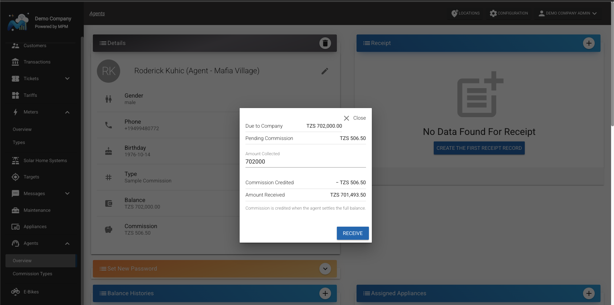

# Charges and receipts

These records track money given to and returned by agents, keeping their balance up to date.

## Agent Charges

An **agent charge** represents money the company gives (or lends) to the agent so that they can continue serving customers.
Charges are created from the agent's profile, via the ":heavy_plus_sign:" button on the **Balance Histories** panel.
A charge **adds** to the balance, because the agent now holds more of the company's money.
When a charge is saved, a matching balance entry is added so it appears in the agent's ledger.

## Agent Receipts

An **agent receipt** records money the agent hands back to the company.
This is how you "collect" an agent's balance from the web.
You create receipts from the agent's profile, via the ":heavy_plus_sign:" button on the **Receipt** panel.

Receipts do the opposite of charges: a receipt **subtracts** from the balance, settling what the agent owes the company.
When a receipt is saved, the system will:

- subtract the amount collected from the balance, recorded in the balance history,
- credit the agent's pending commission as an explicit **Payout** entry in the commission history when they settle in full,
- store a breakdown of the visit — the balance that was owed, what was collected since the last visit, and the commission credited,
- and update the agent's totals — their current balance and the commission they've earned.

### Understanding the receipt dialog

The dialog opens with the agent's position:

- **Due to Company**: the amount of company money the agent currently holds and still has to settle.
- **Pending Commission**: the commission the agent has earned and not yet been credited.

Enter the **Amount Collected** — the money the agent collected that this visit settles.
It defaults to the full Due to Company, and the form rejects anything higher.
Below the field the dialog then shows what follows from it:

- **Commission Credited**: the commission the agent keeps out of that money, credited when they settle the full balance and never more than the amount collected.
- **Amount Received**: the cash to count, which is the amount collected minus the commission credited.

Press **Receive** to save the receipt.
Settling in full clears the balance to zero.
A partial receipt credits no commission, so the whole amount collected is cash received and the commission stays pending until the agent settles completely.

::: details The amount due looks wrong

If the balance looks far too high, the cause is almost always a **commission type that was set up with the wrong scale** — a whole number such as `10` or `50` instead of a fraction like `0.1` or `0.5` (see the warning under [Commission types](/usage-guide/agents/commission-and-balance#commission-types)).
An inflated commission rate distorts every commission figure derived from it.

To recover:

1. Fix the commission type so the rate is a fraction between 0 and 1.
2. Create a receipt to clear the agent's balance back to zero.
3. From then on, new transactions apply the corrected commission.

Pending Commission can also legitimately exceed Due to Company.
Appliance commission is earned on the full appliance price while only the down payment reaches the balance, so an agent selling appliances accrues commission faster than they collect cash.
A receipt never credits more commission than the amount collected, so the remainder simply stays pending.

:::

::: details How each receipt in the list was calculated

The receipt list on the agent profile shows how each receipt was calculated: the amount collected, the commission credited, the cash received, the balance the agent was carrying at the time of the visit, and how much sales activity happened since the last visit.
Amount collected minus commission credited equals the amount received, so each row balances against the cash your records show for that visit.

:::
