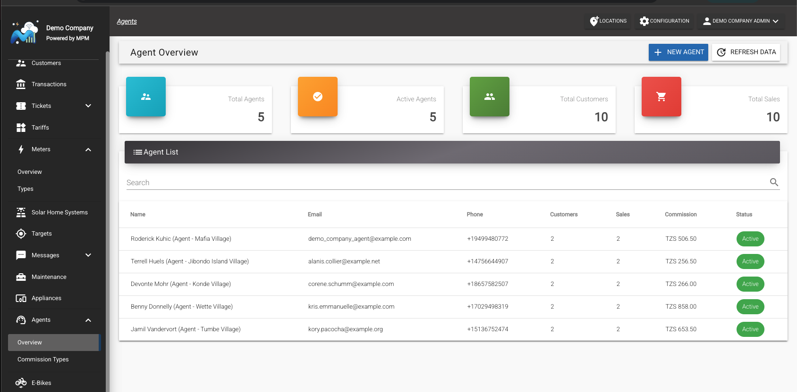

# Overview

Agents are company staff who work on site (or close to it) and serve customers directly.
They register customers, sell appliances, collect payments and hand out tokens in exchange for cash.

Agents do this work in the **MPM Field App**.
This section covers what administrators do on the MicroPowerManager website: setting agents up, assigning their commission, and settling the money they collect.
For what agents do in the app, see [The MPM Field App](/usage-guide/field-app/overview).

## The agent profile

The agent's profile on the website shows everything the agent has done in the Field App:

- **Balance Histories** lists everything that moves the agent's balance — energy sales, appliance sales, and charges that add to it, and receipts that subtract from it — with the current balance shown above the list.
- **Commission Histories** lists commission movements — **Earned** entries for each sale (with the transaction ID it came from) and **Payout** entries created by receipts — with the commission balance shown above the list.
- **Assigned Appliances** lists the appliances the agent may sell, and **Sold Appliances** lists each sale with its customer.
- **Transactions** lists every payment the agent collected.

Each ledger sums to its total, so you can reconcile both figures at a glance.
Customers the agent registers appear in the main **Customers** list like any other customer.
