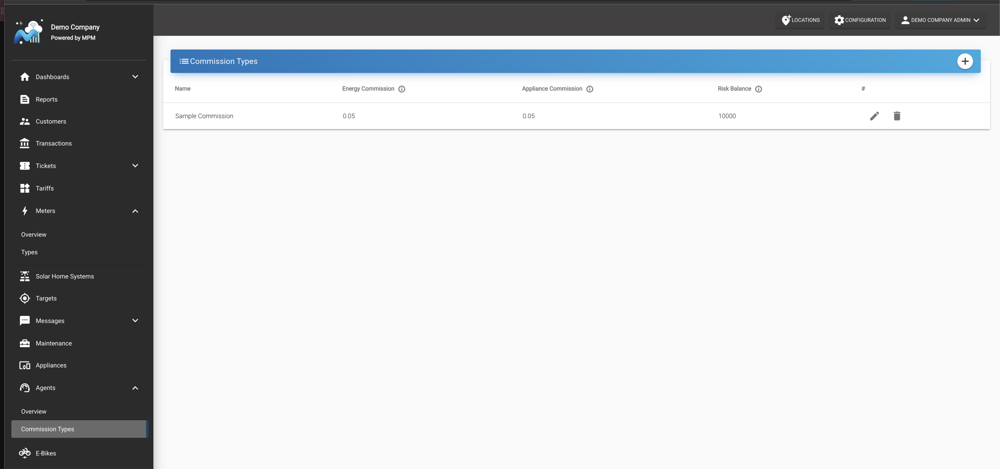
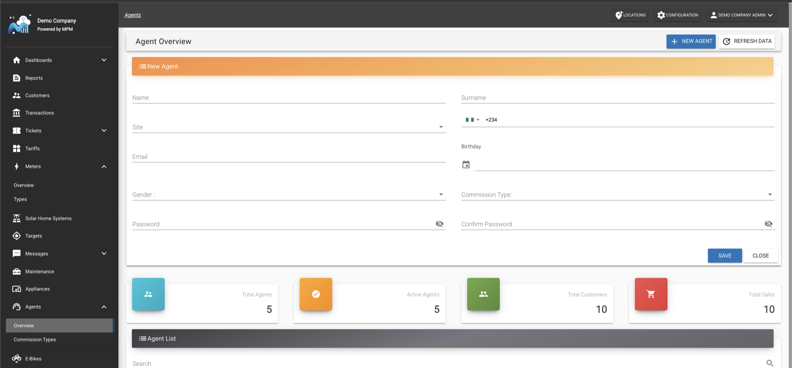
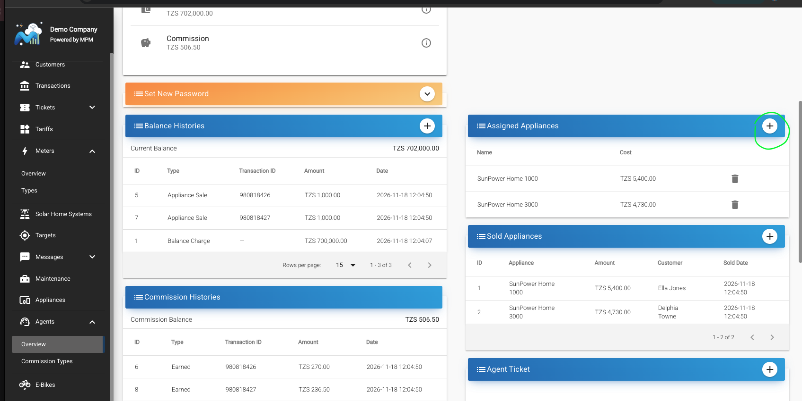

# Setting up an agent

Work through these steps on the website before an agent goes into the field.

1. **Create a commission type.**
   Go to **Agents → Commission Types** and press ":heavy_plus_sign:".
   Enter the energy commission, the appliance commission and the risk balance (see [Commission types](/usage-guide/agents/commission-and-balance#commission-types)).
   You can reuse one commission type for many agents.

   

2. **Create the agent.**
   Go to **Agents → Overview** and press **New Agent**.
   Fill in the form and press **Save**.

   

   - **Site** is the mini-grid the agent works for.
     In the app, the agent only sees and registers customers in the villages of this mini-grid.
   - **Email** and **Password** are the agent's sign-in for the MPM Field App.
     Only agent accounts can sign in to the app; your own website login will not work there.
   - **Commission Type** is the commission type from step 1.

3. **Assign the appliances the agent may sell.**
   Open the agent from the agent list, press ":heavy_plus_sign:" on the **Assigned Appliances** panel, pick the appliance and confirm its **Cost**.
   The cost is the price the agent sells it for in the app.
   It defaults to the appliance's price.
   An agent with no assigned appliances sees "No SHS units assigned to you" when they try to sell.

   

4. **Make sure devices are in stock.**
   Meters and solar home systems must be registered in MicroPowerManager and not yet linked to a customer before an agent can link or sell them.
   See [Meters](/usage-guide/meters) and [Solar Home Systems](/usage-guide/solar-home-systems).

5. **Share the sign-in details with the agent.**
   Give the agent their email and password and point them to [Installing and signing in](/usage-guide/field-app/getting-started).

## Changing an agent's password

The app has no "forgot password" option, so agents ask an administrator for a new password.
Open the agent's profile, expand **Set New Password**, enter the new password twice and save.
Share the new password with the agent.

## Assigning or changing the commission of an agent

1. Create the commission type under **Agents → Commission Types** if it does not exist yet.
2. For a new agent, choose the commission type in the **Commission Type** dropdown of the **New Agent** form.
3. For an existing agent, open the agent's profile, press the pencil icon on the **Details** panel, and choose the commission type from the dropdown.
