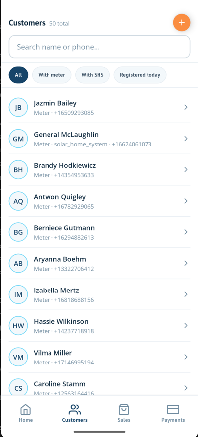
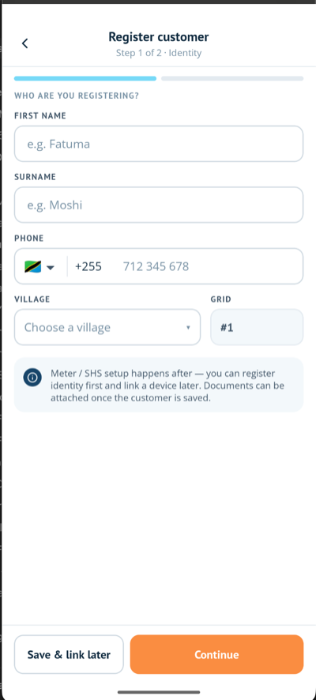

# Customers

The **Customers** tab lists the customers in your mini-grid.
You only see customers who live in the villages of the mini-grid your administrator assigned to you.

Search by name or phone number, or use the filters **All**, **With meter**, **With SHS** and **Registered today**.
Tap a customer to see their devices, payments, documents and answers to onboarding questions, or to call them.

## Registering a customer

1. Tap ":heavy_plus_sign:" on the **Customers** tab (or **Register customer** on **Home**).
2. Fill in the customer's details:
   - **First name**, **Surname**, **Phone** and **Village** are required.
   - **Date of birth** and **Gender** are optional.
   - The app records the customer's location by GPS.
     If it cannot, tap **Retry** or **Pick on map**.
3. Choose how to finish:
   - **Save & link later** saves the customer only.
   - **Continue** saves the customer and goes straight to assigning a meter.

After saving you can answer the company's onboarding questions and add documents for the customer.

> [!NOTE]
> You can register customers without a connection.
> See [Working offline](/usage-guide/field-app/offline-and-sync).

## Assigning a meter

1. Open the customer and tap **Assign meter**.
2. Choose the **Manufacturer**, **Meter type** and **Serial number**.
   Only meters that are not yet linked to a customer are listed.
3. Choose the **Tariff**, **Connection group** and **Connection type**.
4. Tap **Assign meter**.

Solar home systems are not assigned here; they are linked to the customer when you [sell them](/usage-guide/field-app/selling-solar-home-systems).

## Adding documents

A customer can have up to three documents, for example a contract or an ID document.
Tap **Take photo** to photograph a paper document, or **Upload** to add a PDF or Word file of up to 5 MB.
Choose the document type and save.
