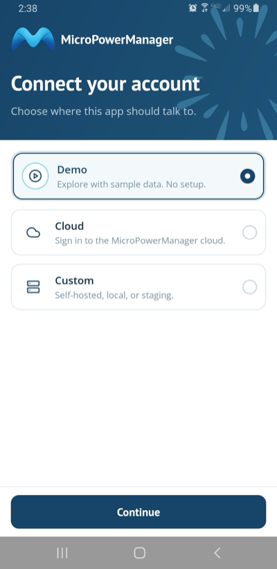
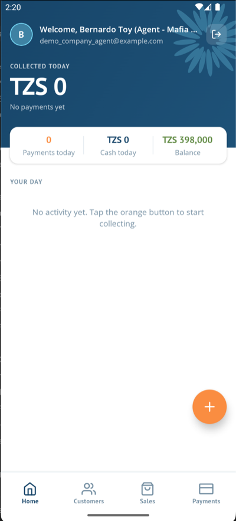

# Getting started

## Installing and signing in

1. Install the app from the store for your device:

   <StoreLinks />

2. Open the app.
   On the **Connect your account** screen, choose where your company's MicroPowerManager runs and press **Continue**:

   | Option     | Choose it when                                                                                     |
   | ---------- | -------------------------------------------------------------------------------------------------- |
   | **Demo**   | You want to try the app with sample data.                                                          |
   | **Cloud**  | Your company uses MicroPowerManager Cloud. This is the usual choice.                               |
   | **Custom** | Your company runs its own MicroPowerManager server. Ask your administrator for the **Server URL**. |

   For **Custom**, enter the full address starting with `https://`, for example `https://mpm.example.com`.
   Do not add `/api` at the end; the app adds it.

   

3. Enter the **Email** and **Password** your administrator gave you and press **Sign in**.

You stay signed in until you sign out.

**Forgot your password?**
The app cannot reset it.
Ask your administrator to set a new one (see [Changing an agent's password](/usage-guide/agents/setting-up-an-agent#changing-an-agent-s-password)).

**Connected to the wrong server?**
Sign out (see [Settings](#settings)), then press **Wrong server? Change** on the sign-in screen.

## Getting around

The bar at the bottom of the screen has four tabs:

| Tab           | What it is for                                                |
| ------------- | ------------------------------------------------------------- |
| **Home**      | Your day at a glance: money collected and your balance.       |
| **Customers** | Find, register and manage your customers.                     |
| **Sales**     | The solar home systems you have sold and their payment plans. |
| **Payments**  | Every payment you have collected.                             |

The orange ":heavy_plus_sign:" button on **Home** is the quickest way to start work.
It offers **Collect payment**, **Sell SHS** and **Register customer**.

## Settings

Open **Settings** with the menu icon at the top right of **Home**.
It shows your name, village and mini-grid, and lets you:

- change the app **Language**,
- check whether your work has been synced to the server (see [Working offline](/usage-guide/field-app/offline-and-sync)),
- **Sign out**.

The app version is shown at the bottom of the screen.
Mention it when you report a problem.

## Home

- **COLLECTED TODAY** is the total of all payments you recorded today.
- **Payments today** is how many payments that was.
- **Balance** is the company money you are currently holding.
  It goes up with every cash payment and sale, and goes down when you hand money over at headquarters.
  If it reaches your limit, the app stops you collecting cash until you settle up.
  See [Commission and balance](/usage-guide/agents/commission-and-balance) for how the balance, commission and limit work.
- **YOUR DAY** lists today's payments and sales.

Pull the screen down to refresh it.
