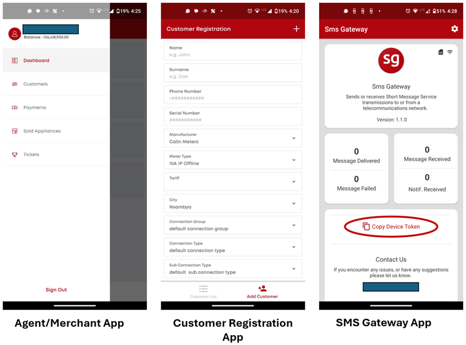

# Overview

The **MPM Field App** is the phone and tablet app for [agents](/usage-guide/agents/overview), the company staff who serve customers in the field.
With it, an agent registers customers, links meters, sells solar home systems, collects payments and hands out tokens.
Everything the agent does appears on the MicroPowerManager website for headquarters to see.

The app is available for Android and iOS.

> [!IMPORTANT]
> Only **agent accounts** can sign in to the app.
> An administrator creates the agent account on the website first (see [Setting up an agent](/usage-guide/agents/setting-up-an-agent)).
> Website (administrator) logins do not work in the app.

## Where your work shows up on the website

Headquarters sees the agent's work on the MicroPowerManager website:

| In the app                  | On the website                                                                                |
| --------------------------- | --------------------------------------------------------------------------------------------- |
| Registering a customer      | **Customers** list                                                                            |
| Collecting a payment        | **Transactions**, and the agent's [profile](/usage-guide/agents/overview#the-agent-profile)   |
| Selling a solar home system | The customer's appliances, and **Sold Appliances** on the agent's profile                     |
| Balance and commission      | **Balance Histories** and **Commission Histories** on the agent's profile                     |
| Handing money over          | A [receipt](/usage-guide/agents/charges-and-receipts#agent-receipts) recorded by headquarters |

## Migrating from the legacy apps

Earlier versions of MicroPowerManager were split across three separate Android apps.
The MPM Field App now covers their day-to-day work in one place.

::: details Which legacy apps does the MPM Field App replace?

| Legacy app                    | Status in the MPM Field App                                                     |
| ----------------------------- | ------------------------------------------------------------------------------- |
| **Customer Registration App** | Replaced by the **Customers** tab (now with offline registration).              |
| **Agent/Merchant App**        | Replaced by **Home**, **Sales**, and **Payments** (including token generation). |
| **SMS Gateway App**           | Not part of the MPM Field App.                                                  |

> [!WARNING]
> The SMS Gateway App is deprecated.
> Sending and receiving SMS is handled by the server-side SMS gateway integrations rather than a phone app.
> See [SMS](/usage-guide/sms), [Africa's Talking](/integrations-guide/communication/africastalking), and [TextBee](/integrations-guide/communication/textbee).

:::

> [!NOTE]
> Ticketing is not yet available.
> Issuing customer tickets from the field is not yet possible in the MPM Field App.
> In the meantime, tickets can be managed from the website interface (see [Tickets](/usage-guide/tickets)).
