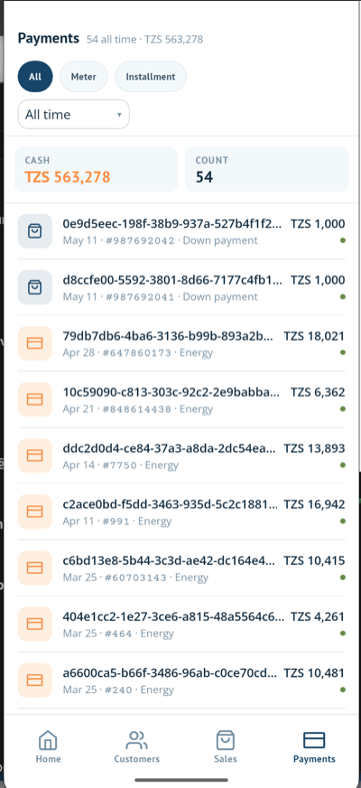
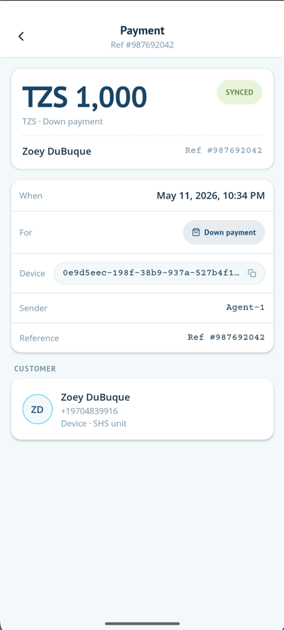

# Payments and tokens

Use this when a customer pays for electricity, or pays an instalment on a system they bought.

1. Tap **Collect payment** from the orange ":heavy_plus_sign:" button on **Home**.
   You can also start it from a customer's device or from a sale, which fills in the device for you.
2. Enter the **Device serial** of the meter or solar home system and tap **Continue**.
3. Enter the **AMOUNT RECEIVED** and tap **Review & confirm**.
   For an instalment, the app shows the minimum and maximum amount allowed.
4. If your company accepts mobile payments, choose the payment method:
   - **Cash**: the customer gives you the money.
     It is added to your balance.
   - A payment provider: the customer pays from their own phone.
     Your balance does not change.
5. Check the summary and tap **Cash received — confirm** (or **Request payment** for a phone payment).
   Only confirm after you have the money in your hand; this cannot be undone.

The app then shows **Payment collected** and waits a few seconds for the token.
Read the **TOKEN** to the customer, or tap it to copy it, so they can enter it on their meter or solar home system.

If the screen shows **NO TOKEN ISSUED**, the payment is still recorded.
The customer receives the token by SMS when it is ready.

The **Payments** tab lists your payments for **Today**, **This week** or **All time**.
Tap a payment to see its details: when it was made, what it was for, the device, who paid and the reference number.
