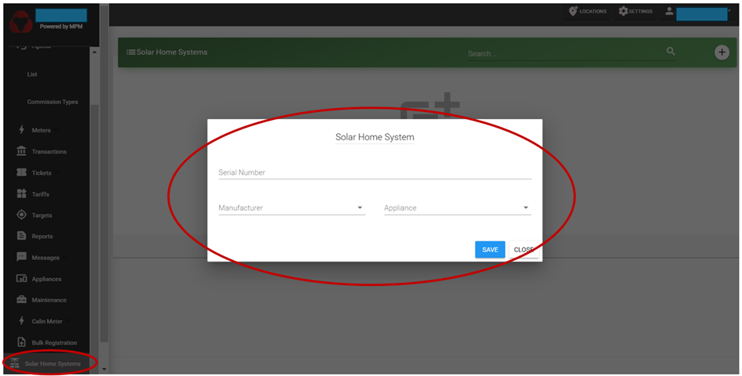

# Solar Home Systems

This is the section listing all SHS devices registered under your company account.
It is the analogous section to the "Meter" menu for mini-grid connections.

SHS devices can be registered via the Customer Registration App (see "Android Apps" section) or directly through the website interface (Select "Solar Home System" menu on the left sidebar --> Click ":heavy_plus_sign:" --> introduce device data as requested.)



## Registering and testing an OpenPAYGO device

Your company must have an OpenPAYGO manufacturer registered, a PayGO-enabled solar home system appliance, and a customer.
The backend and queue worker must be configured to reach the OpenPAYGO generator with the same service API key.
Open MPM at `http://localhost:8001/` when using the development Compose setup.

1. Open **Solar Home Systems** and choose **Register OpenPAYGO Device**.
   Select the manufacturer, appliance and customer, then enter the device's serial number, secret key, starting code, current counter and time divider.
   Use the provisioning values for that particular device; the secret is a 32-character hexadecimal key.
   The browser simulator uses a time divider of `1`; verify the divider for other firmware.
   Use counter `0` only for a fresh device that has not consumed tokens.
2. Open the selected customer's detail page and use the **+** under **Sold Appliances**.
   Choose the same appliance and serial number to create its payment plan.
   A registered device is available to its assigned customer until it has an active sale.
3. For a simple demonstration, select **Energy as a Service**, set the price per day to `10` and minimum payment to `10`.
   Save the sale, open its detail page, and use the payment button to record `20` with a configured payment provider.
   This purchases two days of service.
4. Open the solar home system's detail page and inspect **Solar Home System Transaction**.
   Wait for processing to complete, then copy the token from **In Return**.
   Failed or unresolved processing must show its status; do not make another payment merely to retry token processing.
5. Enter the copied digits in the simulator for the same provisioned device and press **OK**.
   Confirm that the token is accepted and adds two days.
   Repeat with a payment of `10`, confirm another accepted token adds one day, and check that re-entering a consumed token is rejected as a replay.
   A different device with a different secret must reject the token.

Registration clears the entered secret after success or when the form closes.
Duplicate serial numbers and invalid provisioning fields are rejected.
Provisioning updates cannot reset an existing counter or change configuration while an allocated token issuance remains unresolved.
Manual registration is supported; JSON import, QR scanning and a form for editing existing provisioning are outside this workflow.

### Automated regression checks

Use a WSL/Bash terminal for these commands.
From the repository root, start the dedicated testing services and run the backend tests on the host.
The test bootstrap refuses database targets other than the dedicated testing server, because the suite recreates test databases.

```bash
docker compose up -d mysql_testing redis
cd src/backend
composer install
APP_ENV=testing APP_CONFIG_CACHE=/tmp/mpm-openpaygo-testing.php LOG_CHANNEL=null php artisan test tests/Feature/OpenPaygoDeviceRegistrationTest.php tests/Feature/DeviceSaleEligibilityTest.php tests/Feature/OpenPaygoDeviceConfigurationTest.php tests/Feature/AppliancePersonDeviceAssignmentTest.php app/Plugins/OpenPaygo/Tests/Unit
```

From `src/frontend`, with its dependencies installed, run the focused operator tests.
The explicit configuration bypasses the repository's missing `setupTests.js` file.

```bash
npm test -- --runInBand --config '{"setupFiles":[],"moduleNameMapper":{"^@/(.*)$":"<rootDir>/src/$1"}}' src/__tests__/OpenPaygoRegistration.test.js src/__tests__/AppliancePaymentService.test.js
```

Backend integration tests fake the generator response to verify registration, credit conversion, persistence and status reporting.
Acceptance by a real device or simulator must also be checked with the screen workflow above.
