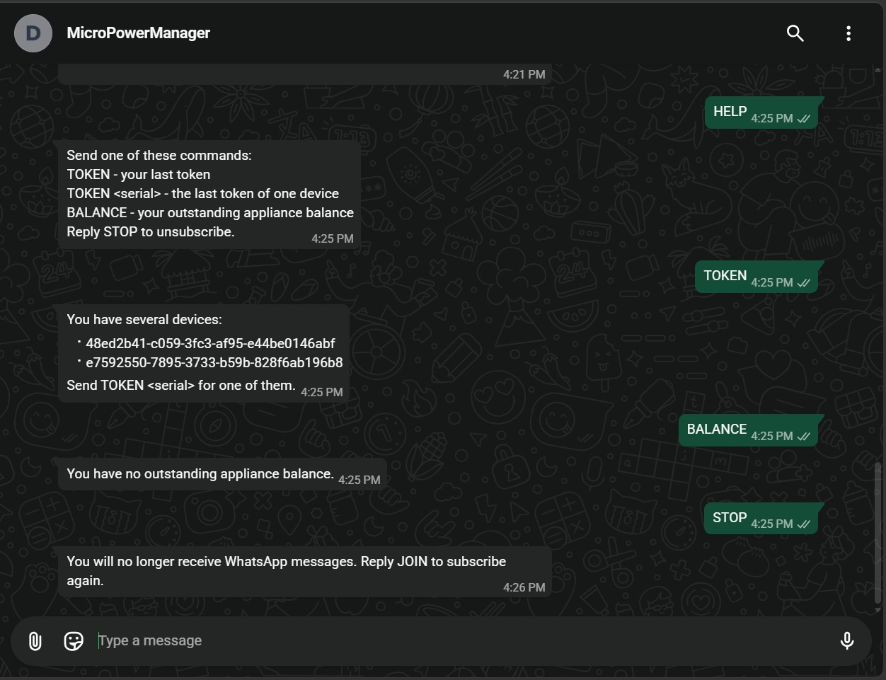
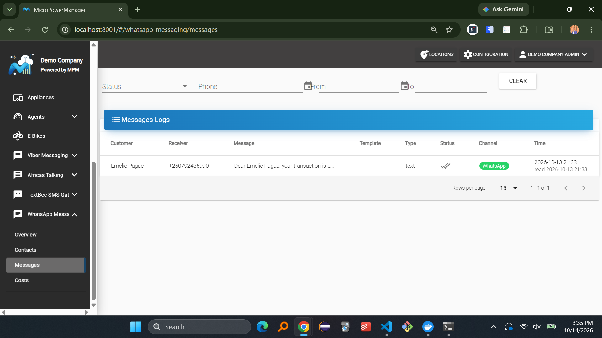
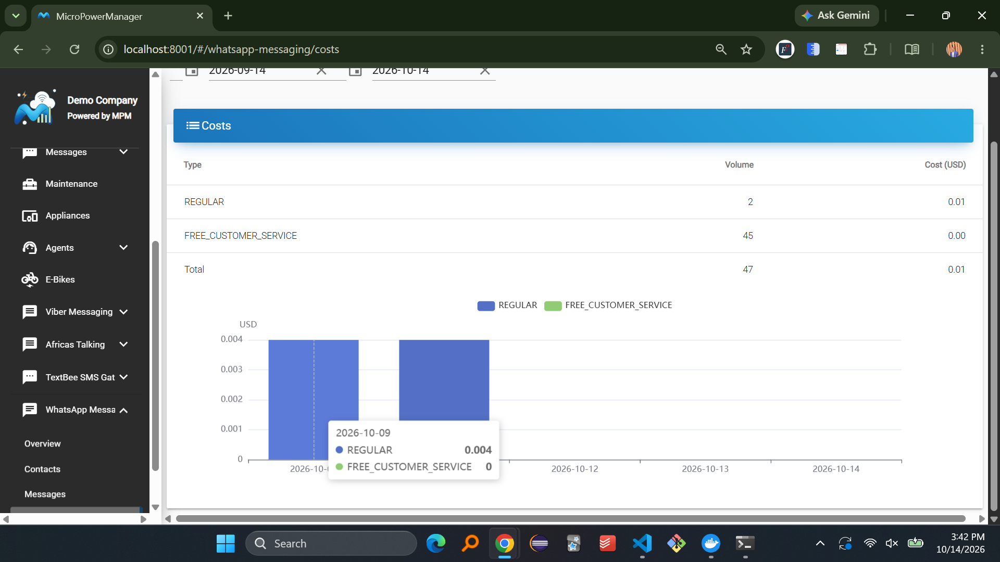

# WhatsApp

With the WhatsApp Messaging plugin, MicroPowerManager sends customer notifications, such as payment receipts and appliance reminders, over WhatsApp.
Customers can also message your WhatsApp number to request their last token or appliance balance themselves.

To set up the plugin, follow the [WhatsApp integration guide](../integrations-guide/whatsapp.md).

## WhatsApp and SMS

WhatsApp does not replace SMS.
For every notification, MPM decides the channel:

1. If the customer has opted in to WhatsApp, the notification is sent over WhatsApp
2. Otherwise, it is sent by SMS through your [SMS gateway](sms)
3. If WhatsApp cannot deliver it, for example because Meta rejected it, it is sent by SMS instead

This means customers who never opt in keep receiving SMS as before.

When Meta is briefly unavailable or asks MPM to slow down, the message is not sent by SMS straight away.
MPM tries WhatsApp once more after 5 minutes, and only sends it by SMS if that second try also fails.

## Opting In

Customers only receive WhatsApp messages after they opt in.
Every opt-in and opt-out is recorded in the customer's [consent history](#whatsapp-consent-on-the-customer-page).

A customer can opt in in any of these ways:

| How                       | What the customer does                                                                                                                           |
| ------------------------- | ------------------------------------------------------------------------------------------------------------------------------------------------ |
| **Keyword**               | Sends **JOIN**, **START** or **YES** to your WhatsApp number                                                                                     |
| **Opt-in link**           | Opens the link from **WhatsApp Messaging** → **Overview**, which opens WhatsApp with **JOIN** already typed, and presses send                    |
| **QR code**               | Scans the QR code from **WhatsApp Messaging** → **Overview** with their phone camera, which opens the opt-in link                                |
| **Operator** (no keyword) | An operator opts the customer in on the [customer page](#whatsapp-consent-on-the-customer-page), for example after the customer agreed in person |

The keyword must be the whole message, in upper or lower case.
A message such as _"I want to JOIN"_ is not treated as an opt-in.
Any other message from a customer who has not opted in gets no answer.

After opting in, the customer receives:

> You are now subscribed to WhatsApp messages. Reply STOP to unsubscribe.

### Sharing the Opt-in Link and QR Code

The opt-in link, for example `https://wa.me/255712345678?text=JOIN`, is the easiest way to reach many customers.
Send it by SMS, or show the QR code next to it to customers in person, for example at your office.
The QR code is view only and cannot be downloaded from MPM.

## Opting Out

A customer can opt out at any time by sending **STOP** or **UNSUBSCRIBE**.
They then receive:

> You will no longer receive WhatsApp messages. Reply JOIN to subscribe again.

From then on, their notifications are sent by SMS again.
An operator can also opt a customer out on the [customer page](#whatsapp-consent-on-the-customer-page).

## Self-Service Bot

Opted-in customers can request information by sending a keyword to your WhatsApp number.
MPM answers straight away, with no work for your staff.

| Keyword            | Reply                                                                           |
| ------------------ | ------------------------------------------------------------------------------- |
| **TOKEN**          | The last payment and token of the customer's device                             |
| **TOKEN** _serial_ | The last payment and token of one device, when the customer has several devices |
| **BALANCE**        | The outstanding appliance balance and the next payment due                      |
| **HELP**           | The list of commands. Any other message gets this same answer                   |

Keywords are not case-sensitive, but a device serial must be typed exactly as it is registered.

### Example Replies

**TOKEN**, for a customer with one device:

> Last payment for 47000123456: 5000 TZS on 2026-10-01. 1234-5678-9012-3456-7890

**TOKEN**, for a customer with several devices:

> You have several devices:
>
> \- 47000123456
>
> \- SHS-00042
>
> Send TOKEN &lt;serial&gt; for one of them.

**BALANCE**:

> Your outstanding appliance balance is 120000 TZS. Next payment: 10000 TZS due on 2026-11-01.

**HELP**:

> Send one of these commands:
>
> TOKEN - your last token
>
> TOKEN &lt;serial&gt; - the last token of one device
>
> BALANCE - your outstanding appliance balance
>
> Reply STOP to unsubscribe.

### Who Can Use the Bot

The customer is identified only by the phone number they write from.
That number must be the phone number of a customer in MPM.
If it is not, the bot answers that the number is not linked to a customer account and asks them to contact your company.

For privacy, the bot only ever answers about the customer's own devices and appliances.
Asking for a serial that belongs to someone else gets the same answer as an unknown serial.

The bot only answers customers who have opted in.

## WhatsApp Consent on the Customer Page

Open a customer to see the **WhatsApp consent** card, right below **Address**.
It shows whether the customer is opted in, the WhatsApp number, and their consent history.

The WhatsApp number is always the customer's primary phone number from the **Address** section.
To use another number, change the primary address first.

### Opting a Customer In

1. Click **Opt in** on the **WhatsApp consent** card
2. Enter a **Consent note**, such as how and when the customer agreed
3. Click **Opt in**
   > [!IMPORTANT]
   > Only opt in customers who have agreed to receive WhatsApp messages.
   > The consent note is stored in their consent history as proof.

Once the customer is opted in, the **Opt in** button is replaced by **Opt out**.

### Consent History

The card lists every opt-in and opt-out of the customer, newest first, with:

- the date
- the source: **Customer (keyword)** for keywords, or **Operator** for the customer page
- the user who made the change, for operator changes
- the note, or the exact message the customer sent

## Messages Page

**WhatsApp Messaging** → **Messages** lists every notification MPM tried to send over WhatsApp.
Filter by status, phone number or date.

The **Status** column shows how far the message got: accepted by Meta, sent, delivered, read, or failed.
The **Channel** column shows **WhatsApp**, or **SMS fallback** when the message was sent by SMS instead.

Click a failed message to see the error from Meta and the delivery status of its SMS fallback.

A message that failed because Meta was briefly unavailable shows as failed, and a second row appears when MPM tries again 5 minutes later.
Until that second try, the SMS list shows the notification as sent via WhatsApp.

## Costs Page

**WhatsApp Messaging** → **Costs** shows what Meta charges you for WhatsApp messages in a date range.
It lists the number of messages and the cost per pricing category, with a total, and a daily chart.

