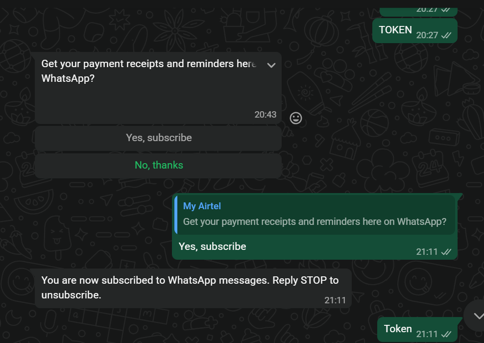
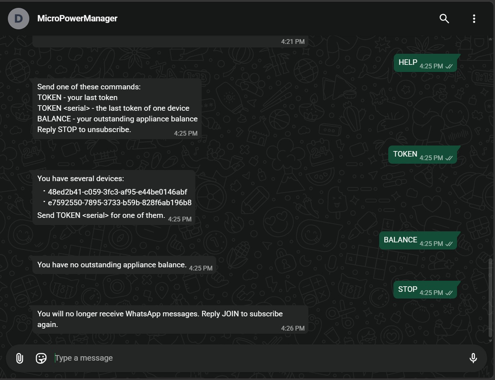
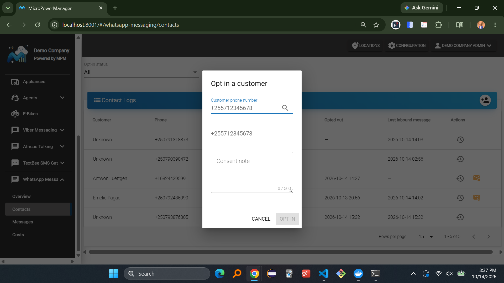
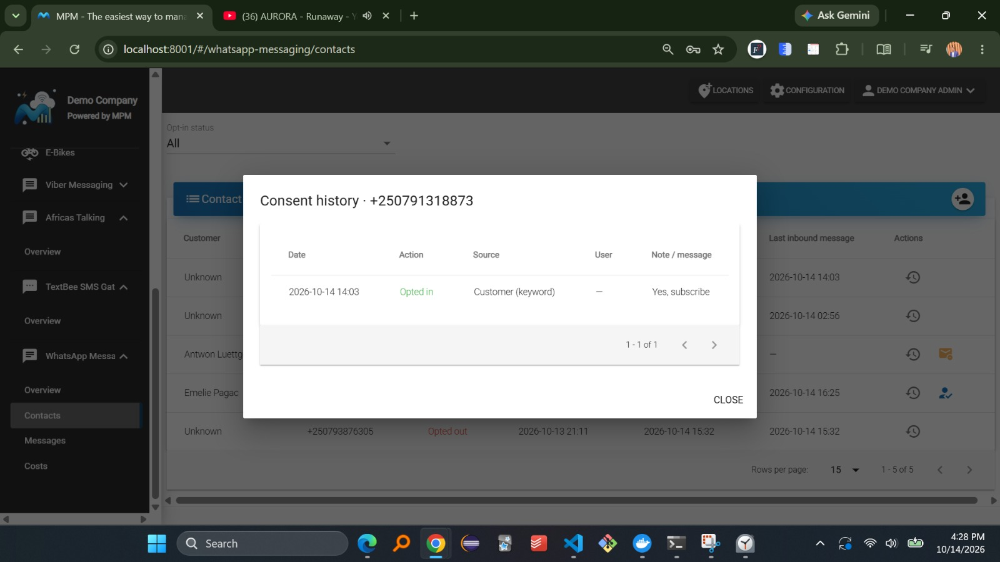
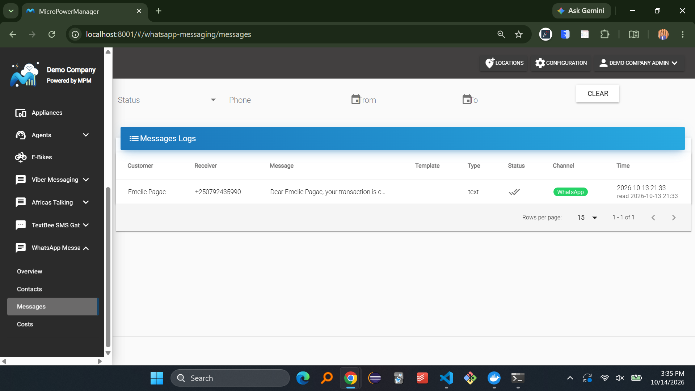
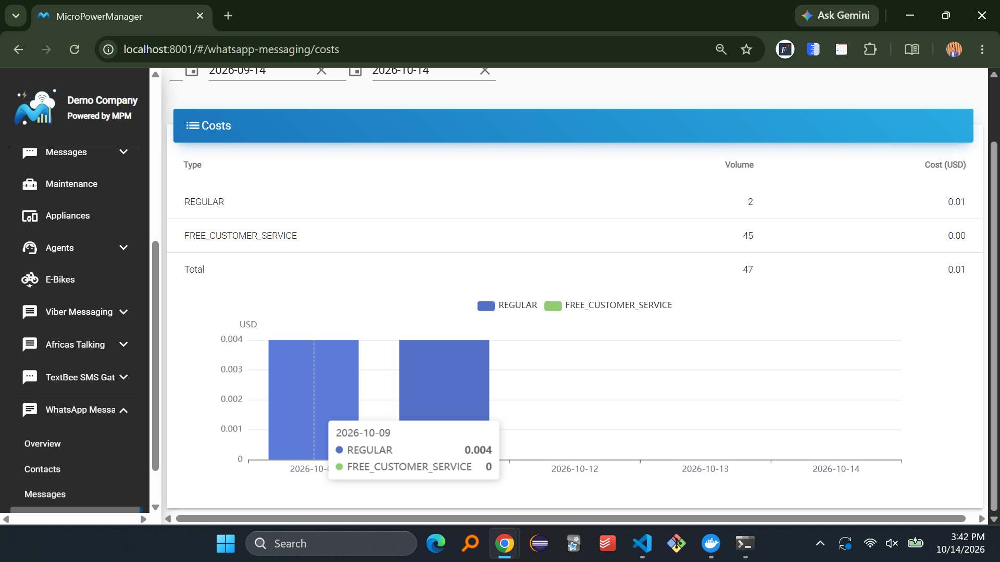

# WhatsApp

With the WhatsApp Messaging plugin, MicroPowerManager sends customer notifications, such as payment receipts and appliance reminders, over WhatsApp.
Customers can also message your WhatsApp number to request their last token or appliance balance themselves.

To set up the plugin, follow the [WhatsApp integration guide](../integrations-guide/whatsapp.md).

## WhatsApp and SMS

WhatsApp does not replace SMS.
For every notification, MPM decides the channel:

1. If the customer has opted in to WhatsApp, the notification is sent over WhatsApp
2. Otherwise, it is sent by SMS through your [SMS gateway](sms)
3. If WhatsApp cannot deliver it, for example because Meta rejected it, it is sent by SMS instead

This means customers who never opt in keep receiving SMS as before.

## Opting In

Customers only receive WhatsApp messages after they opt in.
Every opt-in and opt-out is recorded in the customer's [consent history](#contacts-page).

A customer can opt in in any of these ways:

| How                       | What the customer does                                                                                                        |
| ------------------------- | ----------------------------------------------------------------------------------------------------------------------------- |
| **Keyword**               | Sends **JOIN**, **START** or **YES** to your WhatsApp number                                                                  |
| **Interactive button**    | Taps **Yes, subscribe** on the opt-in question MPM sends                                                                      |
| **Opt-in link**           | Opens the link from **WhatsApp Messaging** → **Overview**, which opens WhatsApp with **JOIN** already typed, and presses send |
| **Operator** (no keyword) | An operator opts the customer in on the [Contacts page](#contacts-page), for example after the customer agreed in person      |

The keyword must be the whole message, in upper or lower case.
A message such as _"I want to JOIN"_ is not treated as an opt-in.

### The Opt-in Question

When a customer who has not opted in writes anything else to your WhatsApp number, MPM answers with a question and two buttons:

> Get your payment receipts and reminders here on WhatsApp?
>
> **[Yes, subscribe]** **[No, thanks]**
> 
> **Yes, subscribe** opts the customer in and **No, thanks** opts them out.
> MPM asks this question at most once every 30 days per number, so customers are not asked again on every message.

After opting in, the customer receives:

> You are now subscribed to WhatsApp messages. Reply STOP to unsubscribe.

### Sharing the Opt-in Link

The opt-in link, for example `https://wa.me/255712345678?text=JOIN`, is the easiest way to reach many customers.
Print it as a QR code on receipts and posters, or send it by SMS.

## Opting Out

A customer can opt out at any time by:

- sending **STOP** or **UNSUBSCRIBE**
- tapping **No, thanks** on the opt-in question

They then receive:

> You will no longer receive WhatsApp messages. Reply JOIN to subscribe again.

From then on, their notifications are sent by SMS again.
An operator can also opt a customer out on the [Contacts page](#contacts-page).

## Self-Service Bot

Opted-in customers can request information by sending a keyword to your WhatsApp number.
MPM answers straight away, with no work for your staff.

| Keyword            | Reply                                                                           |
| ------------------ | ------------------------------------------------------------------------------- |
| **TOKEN**          | The last payment and token of the customer's device                             |
| **TOKEN** _serial_ | The last payment and token of one device, when the customer has several devices |
| **BALANCE**        | The outstanding appliance balance and the next payment due                      |
| **HELP**           | The list of commands. Any other message gets this same answer                   |

Keywords are not case-sensitive, but a device serial must be typed exactly as it is registered.

### Example Replies

**TOKEN**, for a customer with one device:

> Last payment for 47000123456: 5000 TZS on 2026-10-01. 1234-5678-9012-3456-7890

**TOKEN**, for a customer with several devices:

> You have several devices:
>
> \- 47000123456
>
> \- SHS-00042
>
> Send TOKEN &lt;serial&gt; for one of them.

**BALANCE**:

> Your outstanding appliance balance is 120000 TZS. Next payment: 10000 TZS due on 2026-11-01.

**HELP**:

> Send one of these commands:
>
> TOKEN - your last token
>
> TOKEN &lt;serial&gt; - the last token of one device
>
> BALANCE - your outstanding appliance balance
>
> Reply STOP to unsubscribe.

### Who Can Use the Bot

The customer is identified only by the phone number they write from.
That number must be the phone number of a customer in MPM.
If it is not, the bot answers that the number is not linked to a customer account and asks them to contact your company.

For privacy, the bot only ever answers about the customer's own devices and appliances.
Asking for a serial that belongs to someone else gets the same answer as an unknown serial.

The bot only answers customers who have opted in.
Customers who have not opted in get the [opt-in question](#the-opt-in-question) instead.

## Contacts Page

**WhatsApp Messaging** → **Contacts** lists every phone number that has written to your WhatsApp number or has been opted in.
For each contact, it shows the customer, phone number, opt-in status, when they opted in or out, and their last message.

Use the **Opt-in status** filter to show only opted-in or opted-out contacts.

### Opting a Customer In

1. Click **Opt in a customer**
2. Type the customer's phone number (at least 3 digits) and press **Enter**
3. If several customers match, choose the right one from the list
4. Optionally, enter a **Phone override** to use a different number than the customer's primary phone
5. Enter a **Consent note**, such as how and when the customer agreed
6. Click **Opt in**
   
   > [!IMPORTANT]
   > Only opt in customers who have agreed to receive WhatsApp messages.
   > The consent note is stored in their consent history as proof.

To opt in or opt out an existing contact, use the buttons in the **Actions** column.

### Consent History

Click the history icon of a contact to see every opt-in and opt-out, with:

- the date
- the source: **Customer (keyword)** for keywords and buttons, or **Operator** for the Contacts page
- the user who made the change, for operator changes
- the note, or the exact message the customer sent
  

## Messages Page

**WhatsApp Messaging** → **Messages** lists every notification MPM tried to send over WhatsApp.
Filter by status, phone number or date.

The **Status** column shows how far the message got: accepted by Meta, sent, delivered, read, or failed.
The **Channel** column shows **WhatsApp**, or **SMS fallback** when the message was sent by SMS instead.

Click a failed message to see the error from Meta and the delivery status of its SMS fallback.

## Costs Page

**WhatsApp Messaging** → **Costs** shows what Meta charges you for WhatsApp messages in a date range.
It lists the number of messages and the cost per pricing category, with a total, and a daily chart.

